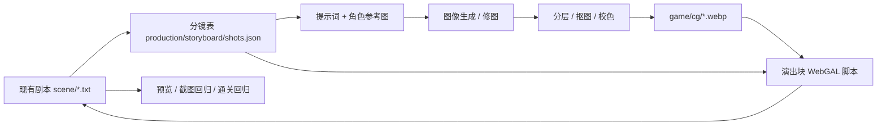

# 《夏日幻想》剧情 CG 与 2D 演出系统 · 设计开发文档

| 项目 | 内容 |
| --- | --- |
| 文档版本 | v0.1（设计稿，待评审） |
| 编写日期 | 2026-11-17 |
| 适用工程 | `D:\galgame\games\summer_fantasy` |
| 引擎 | WebGAL 4.6.6（Terre 编辑器） |
| 覆盖范围 | 序章 + 第一～七章 + GOOD / BAD 结局，共 11 个场景文件 |
| 目标 | 用"按剧情生成的 CG + 分层 2D 运镜 + 字卡"替代"一张背景走一整段"，做出 PPT 式演出 |
| 不在范围 | 改引擎源码、做全程动画电影、重写剧本/变量/分支、替换 Live2D 模型 |

---

## 0. 结论摘要（先看这七条）

1. **不需要换引擎，也不需要做视频**。WebGAL 4.6.6 的 `setTransform` / `setAnimation` 支持三种目标：背景 `bg-main`、舞台 `stage-main`、任意立绘 id；`changeFigure` 支持 `-zIndex` 与透明图层。把 CG 拆成"底图 + 人物 + 前景"三层，就能做推、拉、摇、移、视差、入焦，效果已经接近剪映/PPT 的"图文页 + 强调动画"。
2. **按"情绪节点"切镜，不按"每句话"切镜**。全篇规划 **40 个 shot**，其中第一梯队（MVP）**14 个**，每章 3～6 个；单章演出总时长控制在 60～90 秒。
3. **角色一致性走"双轨"**：对话和半身镜头继续用 Live2D（一致性 100%，零生成风险）；只在 Live2D 做不到的镜头（背影、手部、远景、多人合影、动态姿势）才用"以模型截图 + 角色锚点卡"生成的 CG 人物层。
4. **AI 只画画面，不画可读文字**。章节标题、手机短信、应援牌、榜单、倒计时数字、结局卡，一律用引擎 `intro` 叠加或后期排版。这条能消掉 80% 的"AI 出图翻车"。
5. **分层是这次改造的核心资产**，不是副产品。每张 CG 至少产出 `base`（无人物底图）；有人的镜头再产出 `char`（透明人物层）和可选的 `fg`（前景雨丝/窗框/光斑）。同一张底图可以复用到多个 shot，成本递减。
6. **所有演出必须是确定性的纯脚本**，可跳过、可回看、可存档；缺图时能通过关闭演出块降级回现有背景，绝不阻塞剧情推进。
7. **包体预算 +60MB 以内**：40 个 shot 按平均 2.2 个文件、单文件 ≤ 400KB 计算，约 35MB；参考图、提示词、源文件放在 `production/`，不随游戏发布。

> 本文既是设计说明，也是施工图：第 6 节给出 40 个 shot 的具体机位和插入位置，第 7 节给出可直接复制的 WebGAL 脚本模板，第 9 节给出从提示词到验收的完整 SOP。
>
> 与现有文档的分工：`开发文档.md` 管剧情、分支与变量；`开发说明.md` 管工程现状与运行；`背景生图提示词.md` 管场景背景；**本文件管剧情 CG、分层资产与 2D 演出**。

---

## 1. 现状与问题

### 1.1 现有素材盘点

| 类别 | 数量 | 说明 |
| --- | ---: | --- |
| 背景 | 22 张 | 1920×1080 WebP，21 张已接入，`title_bg` 备用 |
| Live2D 模型 | 3 套 | 阮乐茹、刘熙朗、兰屿，各 10 个 `mood_*` 表情 + 2 个待机动作 |
| 内置动画 | 34 个 | `enter/exit/shake/blur/oldFilm/...`，目前剧本只用了 `pixiPerform:rain` |
| 天气特效 | 4 种 | `rain / snow / cherryBlossoms / heavySnow` |
| BGM | 1 首 | `s_Title.mp3` 贯穿全篇 |
| 语音 | 100+ 条 | 按章节命名，覆盖主要台词 |
| 剧情 CG | **0 张** | CG 鉴赏为空 |

当前演出手段只有：`changeBg` 淡入淡出 + Live2D 立绘缩放/换表情 + 下雨。全篇没有一个"镜头"概念。

### 1.2 具体问题

1. **景别单一**：所有场景都是同一张 1920×1080 全景，人物永远半身居中，缺少特写、过肩、远景。
2. **没有纵深**：没有前景层，画面像"背景板 + 贴纸"，雨丝也只能靠 Pixi 全屏粒子。
3. **转场单一**：几乎全是默认淡入淡出，情绪高点（山顶、生日、递水、擦肩）没有"画面重音"。
4. **叙事信息密度低**：书签、信纸、应援牌、榜单这些关键道具，全靠台词描述，没有给到画面。
5. **对比不足**：好结局"夏日校门"与坏结局"冬日走廊"是仅有的冷暖对比，中间章节缺少色彩记忆点。
6. **CG 鉴赏为空**：玩家没有可回看的"名场面"，二周目动力弱。

### 1.3 改造目标（可验收）

| 维度 | 目标 | 度量方式 |
| --- | --- | --- |
| 覆盖率 | 每章 ≥ 3 个 CG 演出点 | 分镜表 vs 场景文件 |
| 规模 | 全篇 40 shot（P0 14 / P1 15 / P2 11） | `production/storyboard/shots.json` |
| 节奏 | 关键节点停留 ≥ 4s，单章演出 ≤ 90s | 脚本时长统计 |
| 镜头语言 | ≥ 12 种镜头 preset，≥ 6 种转场 | 模板清单 |
| 性能 | 桌面 ≥ 55fps、移动端 ≥ 30fps；单场景常驻大图层 ≤ 3 | Chrome Performance / 真机 |
| 包体 | 增量 ≤ 60MB | 导出包对比 |
| 稳定性 | 0 脚本错误；8 条既有路线结局不变 | `validate_scene` + 自动通关 |
| 可逆性 | 跳过/自动/回看/存读档均不改变剧情结果 | 手工 + 自动回归 |
| 降级 | 缺任意 CG 时回退到现有背景，仍可通关 | 删除测试 |

---

## 2. 设计原则

1. **叙事优先**：只在"信息变化 / 情绪转折 / 空间转换"处切镜；不为炫技加镜头。一段普通对话不值得一张 CG。
2. **三层构图**：远景交代环境 → 中景交代关系 → 特写交代情绪。每章至少各一个。
3. **动效克制**：推拉幅度 ≤ 8%，单段时长 ≥ 4s，位移 ≤ 40px，缓动默认 `easeOut`/`easeInOut`。宁可"几乎不动"，也不要"PPT 抖动"。
4. **分层优先**：能拆 `base / char / fg` 就拆。拆层带来的视差和可控性，比一张"完美整图"更有价值。
5. **复用优先**：现有 21 张背景先作为 `base` 候选；同一机位只补人物层或前景层，不重复生成整张。
6. **文字后置**：一切需要"读"的内容（标题、短信、榜单、牌面、数字）都不交给图像模型。
7. **可降级**：CG 是增强，不是前置依赖；缺图时必须回落到现有背景 + 立绘。
8. **一次只加一种变量**：同一 shot 内不同时做"换背景 + 换立绘 + 大运镜 + 白闪"，避免调试困难。

### 2.1 "PPT 式"到底指什么

| PPT 元素 | 游戏内对应 | 实现手段 |
| --- | --- | --- |
| 封面页 | 章节标题卡 | `intro` + 背景 + `filmMode` |
| 目录页 | 时间/地点卡 | `intro` 两行文字 |
| 图文页 | CG + 旁白 | `changeBg` + 文本框 |
| 强调动画 | 局部推近 / 轻微放大 | `setTransform` 改 `scale` |
| 切换动画 | 推入 / 淡出 / 白闪 | `changeBg -enter/-exit` + 白图 |
| 结束页 | END 卡 | `intro` + `filmMode` |
| 演讲节奏 | 台词停顿、留白 | `wait` + 句间空行 |

目标不是"做成 PPT"，而是借用 PPT 的**分页思维**：一页只讲一件事，一页只给一个视觉重点。

---

## 3. 名词与总体架构

| 名词 | 含义 |
| --- | --- |
| shot（分镜） | 一次连续的镜头呈现，对应 3～8 秒画面 + 0～3 句台词 |
| layer（图层） | `base` 无人物底图 / `char` 透明人物层 / `fg` 透明前景层 / `fx` 光效层 |
| beat（拍） | shot 内部的最小节奏单位，通常一句台词一拍 |
| 演出块 | 一段可复制的 WebGAL 脚本，负责"进入 shot → 运镜 → 退出 shot" |
| teardown | 演出结束后的收尾：隐藏图层、恢复文本框/电影模式/BGM |
| 降级 | 素材缺失时跳过演出块，直接使用原背景 |

### 3.1 总体管线



### 3.2 分层架构（运行时）

```text
┌──────────────────────────────────────────────┐
│ 字卡 / intro（DOM，最上层）                    │
├──────────────────────────────────────────────┤
│ 文本框（WebGAL 原生 UI）                       │
├──────────────────────────────────────────────┤
│ flash 白/黑层（figure id=flash，zIndex=90）     │
│ fg 前景层（figure id=cg_fg，zIndex=30）         │
│ char 人物层（figure id=cg_char，zIndex=10）     │
│ Live2D 立绘（对话时使用，不与该层同时出现）       │
├──────────────────────────────────────────────┤
│ 背景 / CG 底图（bg-main）                      │
├──────────────────────────────────────────────┤
│ 舞台（stage-main，用于整体震动/缩放）            │
└──────────────────────────────────────────────┘
```

---

## 4. 资产规范

### 4.1 目录结构

```text
summer_fantasy/
├─ production/                    # 制作源文件，不随游戏导出
│  ├─ storyboard/
│  │  ├─ shots.json               # 分镜唯一数据源（M1 建立）
│  │  └─ shots.schema.json
│  ├─ ref/                        # 角色参考图集
│  │  ├─ leru/
│  │  ├─ liu/
│  │  └─ lanyu/
│  ├─ prompts/                    # 每个 shot 的提示词与参数记录
│  └─ source/                     # 原始出图、psd、分层源文件
├─ game/
│  ├─ cg/                         # 发布用图层
│  │  ├─ ch00/
│  │  ├─ ch01/
│  │  ├─ ...
│  │  └─ ui/                      # white.webp / black.webp 等
│  ├─ video/                      # playVideo 专用（可选）
│  ├─ sfx/                        # 新增音效（可选）
│  └─ scene/                      # 现有剧本
└─ tools/                         # 项目内校验、截图、回归脚本（随工程走）
```

> `production/` 放在 `game/` 之外，WebGAL 导出时只会打包 `game/` 与 `lib/`，参考图和源文件不会进包。
>
> 校验脚本放在工程内的 `tools/`，不写到 `D:\galgame\_tools`（那是跨工程共享目录，且不一定有写权限）；现有 `_tools/validate_scene.js` 仅作为参考实现，可复制一份到 `tools/` 后扩展。

### 4.2 命名规范

```text
<章>_<两位序号>_<内容>_<层>.webp

ch00_01_bookmark_base.webp
ch00_01_bookmark_fg.webp
ch01_03_umbrella_char.webp
ch04_02_letter_base.webp
```

- 全小写英文 + 下划线；禁止中文、空格、大写（避免 URL 编码与跨平台问题）。
- 序号在章内递增，与 `shots.json` 的 `id` 对应。
- 未验收版本加 `_v02`、`_v03`；验收通过后去掉版本后缀。
- `base` 不透明；`char` / `fg` 必须带 alpha。
- 同一 shot 的所有图层**画布尺寸与坐标必须一致**，方便直接叠加。

### 4.3 技术规格

| 项目 | 规格 |
| --- | --- |
| 画布 | 1920×1080（16:9），sRGB；不做 4K |
| 格式 | WebP（照片感/厚涂）或 PNG→WebP；透明层保留 alpha |
| 质量 | q82～88；单张 ≤ 550KB（base）/ ≤ 350KB（char、fg） |
| 安全区 | 下 300px 不放关键信息（文本框约覆盖 27%～30%） |
| 角色头部 | 位于画面上 2/3；特写时眼睛不低于 y=300 |
| 亮度 | 背景/底图整体压暗 5%～10%，给立绘和字卡留出对比 |
| 版权 | 每张图在 `prompts/<shot>.md` 记录工具、模型、种子、日期 |

### 4.4 分层规则

| 层 | 内容 | 透明 | 典型用途 |
| --- | --- | --- | --- |
| `base` | 环境、道具、无人物 | 否 | 推拉摇移的底图；可与 Live2D 叠加 |
| `char` | 人物（含必要投影） | 是 | 需要生成姿势/背影/多人时使用 |
| `fg` | 雨丝、窗框、花枝、光斑、栅栏 | 是 | 视差、景深、遮挡，制造纵深 |
| `fx` | 光晕、尘埃、白闪 | 是 | 叠加混合，慎用 |

分层注意：

1. `char` 的脚底/腰部以下可以裁掉，但**头顶和手不能贴边**，给运镜留 5% 余量。
2. `fg` 只保留画面边缘 15%～25% 的区域，中间留空，避免挡脸。
3. 人物投影画在 `char` 层内，不画在 `base` 上，否则视差时投影会"脱脚"。
4. 分层后必须做一次"叠加预览"：`base + char + fg` 三层对齐，无白边、无色差。

### 4.5 版本与清单

`production/storyboard/shots.json` 是唯一数据源，每个 shot 至少记录：

```json
{
  "id": "ch04_01_window",
  "chapter": "ch04_birthday",
  "priority": "P0",
  "anchor": { "type": "line_contains", "text": "乐茹已经坐在靠窗的位置" },
  "duration": 5200,
  "layers": ["ch04_01_window_base.webp", "ch04_01_window_char.webp"],
  "prompt": "production/prompts/ch04_01_window.md",
  "refs": ["production/ref/leru/front.png", "production/ref/leru/expr_soft.png"],
  "seed": 184729,
  "tool": "<生成工具名>",
  "status": "approved",
  "qa": { "consistency": 4, "hands": "ok", "text": "none", "safeArea": "ok" }
}
```

`status` 取值：`todo / generated / layered / approved / dropped`。没有 `approved` 的素材不允许进 `game/cg/`。

---

## 5. 角色一致性与参考体系

这是整个项目最大的风险点，也是决定"像不像同一部作品"的关键。

### 5.1 双轨策略

| 镜头类型 | 方案 | 一致性 | 成本 | 说明 |
| --- | --- | --- | --- | --- |
| 对话、半身、表情变化 | **Live2D 直接入镜** | 100% | 0 | 现有能力，继续用 |
| 背影、全身、远景、多人、手部、动态姿势 | **生成 CG 人物层** | 80%～95% | 中 | 用模型截图做参考 |
| 纯环境、道具特写 | **生成空镜** | — | 低 | 不涉及人脸，最稳 |

**优先级**：能用 Live2D 就不用生成；必须生成时，优先选"不露正脸"的构图（背影、侧影、逆光、局部、遮挡）。这不是妥协，而是视觉语言本身——青春期故事里，背影和手往往比正脸更有戏。

### 5.2 参考图集（M1 必须产出）

来源二选一：

- **Cubism Viewer**：打开 `game/figure/<角色>/<角色>.model3.json`，关闭物理/呼吸，固定参数，导出透明 PNG；
- **WebGAL 内截图**：进入预览，隐藏文本框与 UI，纯色背景，按 2× 分辨率截取，再裁切。

每个角色至少 15 张：

| 编号 | 内容 | 用途 |
| --- | --- | --- |
| `front` | 正面半身，默认表情 | 主参考 |
| `three_quarter` | 3/4 侧半身 | 侧脸镜头 |
| `side` | 正侧脸 | 对视、过肩 |
| `full` | 全身（含校服/鞋） | 远景、全身构图 |
| `back` | 背面（可由正面推断或补画） | 背影镜头 |
| `expr_*` | 10 个表情各一张 | 情绪匹配 |
| `detail_face` | 脸部特写 | 近景 |
| `detail_hand` | 手部（自然下垂/持物） | 手部特写 |
| `detail_item` | 角色专属道具（乐茹的书签、兰屿的应援牌） | 道具连续性 |

规格：PNG + alpha，长边 2048，命名 `ref/<char>/<part>.png`，纯灰底另存一份 `*_gray.png` 便于比对。

### 5.3 角色锚点卡

> **下表带 `<待填>` 的单元格，必须在 M1 用模型截图逐项确认后填写，不允许凭印象写。** 锚点卡是提示词和验收的共同依据。

| 项目 | 阮乐茹 | 刘熙朗 | 兰屿 |
| --- | --- | --- | --- |
| 发色 | `<待填>` | `<待填>` | `<待填>` |
| 瞳色 | `<待填>` | `<待填>` | `<待填>` |
| 发型 | 马尾（故事明确）/ `<待填>` | `<待填>` | `<待填>` |
| 身高/体型 | 个子不高、手小（故事明确） | 高个、校队主力 | `<待填>` |
| 校服 | `<待填>` | `<待填>` | `<待填>` |
| 标志物 | 山形木书签、素色信纸 | 篮球、毛巾、球衣 | 应援牌、饮料 |
| 气质关键词 | 安静、轻、容易脸红 | 直率、讲义气、藏心事 | 笑眯眯、活泼、藏不住 |
| 禁止项 | 成熟化、浓妆、改变身高差 | 痞化、肌肉夸张 | 女性化、幼化 |

### 5.4 生成策略阶梯

按"从省到贵"排序，能用上层就不用下层：

- **A. 空镜生成**：只生成环境，人物由 Live2D 叠加。适用于教室、走廊、球场、河堤等对话场景。
- **B. 强参考生成**：把 `front + three_quarter + expr_*` 作为多图参考，提示词写"与参考图同一角色、同一校服"，固定 seed 与风格词。适用于中景、3/4 侧。
- **C. 角色 LoRA**：用 30～50 张模型多角度/表情图训练轻量 LoRA（SDXL / Illustrious 系），再配合同系列风格模型。适用于需要大量同角色镜头的阶段。
- **D. 局部重绘/手工修**：手、眼睛、校服领口、双人交叠处，用 inpaint 或手绘修。**每张人物图都必须过这一关。**

### 5.5 参考投喂模板

```text
[参考图 1] production/ref/leru/front.png        ← 主形象
[参考图 2] production/ref/leru/three_quarter.png ← 侧脸结构
[参考图 3] production/ref/leru/expr_soft.png     ← 表情
[参考图 4] production/ref/leru/detail_item.png   ← 书签

角色：与参考图完全相同的少女，同一发型、同一校服、同一配饰；
禁止改变发色、瞳色、身高比例、校服款式。
```

不同工具的"参考"能力不同，落地时按实际工具改写，但**"同一角色 + 禁止改动项"这两句必须保留**。

### 5.6 一致性验收（1～5 分，≥4 通过）

| 检查项 | 判定标准 | 硬性 |
| --- | --- | --- |
| 发色 | 与锚点卡一致，色相偏差可接受 | 是 |
| 瞳色 | 与锚点卡一致 | 是 |
| 发型/长度 | 轮廓一致，刘海方向一致 | 是 |
| 校服 | 领型、颜色、徽章位置一致 | 是 |
| 身高差 | 双人镜头中符合设定 | 是 |
| 配饰 | 书签/应援牌/毛巾等连续 | 是 |
| 画风 | 与现有背景同一"日系动画厚涂"体系 | 是 |
| 手 | 五指数量、关节方向正确 | 是 |
| 脸型 | 与模型三视图接近，不"换人" | 是 |
| 气质 | 不成熟化、不幼化、不写实化 | 是 |

任一项不过 → 重生成或换构图（改成背影/局部/剪影），不要硬修。

### 5.7 已知难点与规避

| 难点 | 规避手段 |
| --- | --- |
| 手部崩坏 | 手持道具（书签、信纸、水瓶、伞柄）；裁切到手腕；用 `fg` 遮挡；必要时手绘 |
| 侧脸/3/4 脸漂移 | 优先用模型 `side` 参考；改成过肩或逆光剪影 |
| 双人互动（递水、握手、撑伞） | **分层生成再合成**：两人分别生成，在 PS/ComfyUI 里按透视摆放，统一光源 |
| 多人合影（结局四人） | 不做一张整图；用"空景校门 + 四个透明人物层 + 统一投影"合成 |
| 文字/数字乱码 | 画面留白，文字后期叠加（见 7.6） |
| 复杂姿势 | 改构图：背影、侧影、局部、远景小人物 |
| 风格漂移 | 固定风格前缀 + 固定负面词 + 同批次生成；每章先出 1 张"风格锚图"再批量 |

---
---

## 6. 分镜设计（40 shot）

### 6.1 制作方式图例

| 代号 | 方式 | 说明 | 一致性风险 |
| --- | --- | --- | --- |
| **A** | 生成人物层 | `base + char`（必要时 `+fg`），人物由 AI 按参考图生成 | 高，需过 5.6 验收 |
| **B** | 生成空镜 | `base`（必要时 `+fg`），画面无人物，人物由台词/立绘承担 | 低，最稳 |
| **C** | 空镜 + Live2D | `base` 生成，角色用现有 Live2D 叠加 | 零 |
| **D** | 合成 | 手、道具、多人、文字贴图，分层拼 | 中，靠人工 |

**排期原则**：先做 B/C（快、稳、能立刻改善观感），再做 A（慢、贵、但出"名场面"）。每个 P0 章至少保证 1 个 A 级镜头作为记忆点。

### 6.2 镜头语言

**景别**

| 景别 | 画面范围 | 用途 |
| --- | --- | --- |
| 远景 | 人物占画面高度 < 1/4 | 交代环境、孤独感、时间流逝 |
| 全景 | 人物全身 | 空间关系、走位 |
| 中景 | 腰以上 | 对话、关系 |
| 近景 | 胸以上 | 情绪 |
| 特写 | 脸/手/道具 | 情绪重音、信息 |
| 微距 | 局部细节 | 书签、信纸、指尖、牌面 |

**机位**：平视（默认）、俯拍（写字、看手机、压迫感）、仰拍（擦黑板、仰望）、过肩（对视、偷看）、背面（离别、擦肩）。

**构图**：三分法（默认）、对称（擦肩、走廊）、框中框（门口、车窗、玻璃柜）、大留白（山顶、空走廊）。

**运镜幅度**（硬性上限）：

| 类型 | 缩放 | 位移 | 时长 |
| --- | --- | --- | --- |
| 慢推 | 1.00→1.05～1.08 | ≤ 25px | 4～6s |
| 慢拉 | 1.06→1.00 | ≤ 25px | 4～6s |
| 横移/竖移 | 不变 | ≤ 40px | 5～7s |
| 视差 | 不变 | 前景与背景反向 8～20px | 5～7s |
| 快推（重音） | 1.00→1.10 | ≤ 10px | 1.5～2.5s |
| 呼吸微动 | ±0.01 | 0 | 4s 往返 |

### 6.3 逐章分镜表

> "插入位置"引用现有剧本中的台词片段或 `label`。实际施工时在该句**之后**插入演出块；若该句在 `choose` 分支内，插在分支 `label` 之后的第一句。
>
> **优先级**：● P0（MVP 必做） / ○ P1（加分） / △ P2（可选）。

#### 6.3.1 序章（`ch00_prologue.txt`）

| ID | 优先级 | 方式/层 | 插入位置 | 画面与构图 | 运镜 / 时长 | 转场 / 音效 |
| --- | --- | --- | --- | --- | --- | --- |
| `p0_01_first_meet` | ○ | C `base+L2D` | 「她抱着书从门口进来」后 | 教室门口逆光，乐茹抱书中景，纵深课桌，窗帘透光 | 1.04→1.00 拉，5s | 叠化 600ms / 蝉鸣 |
| `p0_02_bookmark` | ● | B `base+fg` | 「那是一枚山形的书签」后 | 桌面俯拍微距：木书签、摊开的课本、窗格光斑 | 1.00→1.06 推，4s | 硬切 / 翻页声 |
| `p0_03_finger` | ○ | A `base+char` | 「指尖碰到我的手心」后 | 两只手交接书签，浅景深，背景是校服与课本 | 静帧微推，3.5s | 硬切 / 心跳 |
| `p0_04_wave` | ● | A `base+char` | 「冲我轻轻挥了挥手」后 | 教室门口，乐茹回头挥手，逆光远景，走廊纵深 | 1.00→1.05 推，5s | 慢叠化 1s / 放学铃 |

#### 6.3.2 第一章（`ch01_daily.txt`）

| ID | 优先级 | 方式/层 | 插入位置 | 画面与构图 | 运镜 / 时长 | 转场 / 音效 |
| --- | --- | --- | --- | --- | --- | --- |
| `c1_01_blackboard` | ○ | C `base+L2D` | `d1_help`「我踩上去」后 | 仰拍黑板，粉笔灰在光柱里，乐茹仰脸 | 低角度缓推，4s | 叠化 / 粉笔声 |
| `c1_02_rainwindow` | ● | C `base+L2D` | `changeBg:classroom_rain` + `pixiPerform:rain` 后 | 窗玻璃雨珠，室内冷光，乐茹侧影，桌上课本 | 横移 30px，5s | 叠化 / 雨声 |
| `c1_03_umbrella` | ● | A `base+char+fg` | `d2_share`「我撑开伞」后 | 雨中校道双人背影，伞面雨珠，前景雨丝虚化 | 跟移 + 视差，6s | 慢叠化 / 雨声 |
| `c1_04_three` | △ | A `base+char+fg` | 「球划出一道弧线」后 | 夕阳球场，熙朗起跳剪影，铁丝网前景，长影 | 1.00→1.10 快推，3s | 硬切 / 入网声 |
| `c1_05_court` | △ | C `base+L2D` | 「看见兰屿拉着乐茹」后 | 人群虚化，兰屿与乐茹中景，球场逆光 | 轻推，4s | 叠化 / 环境声 |

#### 6.3.3 第二章（`ch02_saturday.txt`）

| ID | 优先级 | 方式/层 | 插入位置 | 画面与构图 | 运镜 / 时长 | 转场 / 音效 |
| --- | --- | --- | --- | --- | --- | --- |
| `c2_01_phone` | ● | B `base+fg` | 「我盯着手机屏幕」后 | 夜晚书桌俯拍，手机屏幕留白，台灯光圈，两杯冷掉的茶 | 微推，4s | 硬切 / 提示音 ×2 |
| `c2_02_trail` | ○ | A `base+char` | 「这个叫一年蓬」后 | 乐茹蹲下指花，林间光斑，侧背影，草叶前景 | 低机位缓移，5s | 叠化 / 虫鸣 |
| `c2_03_summit` | ● | A `base+char+fg` | 「山顶的风很大」后 | 城市与海，乐茹站栏杆边的小人物，风吹发，云影 | 1.00→1.08 推，6s | 长叠化 / 风声 |
| `c2_04_eyes` | ○ | A `base+char×2` | 「是很好」前 | 两人侧脸对视，天空占 2/3，栏杆在下缘 | 静帧微推，4s | 硬切 / 静音 300ms |
| `c2_05_netcafe` | △ | C `base+L2D` | 「网吧里烟雾缭绕」后 | 蓝光与烟雾，熙朗侧影盯屏，屏幕虚化 | 横移，4s | 叠化 / 键盘声 |

#### 6.3.4 第三章（`ch03_birthday_pre.txt`）

| ID | 优先级 | 方式/层 | 插入位置 | 画面与构图 | 运镜 / 时长 | 转场 / 音效 |
| --- | --- | --- | --- | --- | --- | --- |
| `c3_01_corridor` | ○ | C `base+L2D` | 「下周六，乐茹生日」后 | 走廊尽头逆光，兰屿靠窗，半剪影 | 缓推，4s | 叠化 / 风声 |
| `c3_02_bookmark` | ● | B `base+fg` | 「玻璃柜里有一枚山形书签」后 | 玻璃柜台内书签特写，暖钨丝灯，玻璃反光 | 微距推，4s | 硬切 / 店门铃 |
| `c3_03_letter` | ● | D `base+fg+手` | 「台灯下写了很久」后 | 俯拍桌面：信纸、笔、暖光圈，只露手部 | 俯拍缓推，5s | 叠化 / 笔尖声 |
| `c3_04_walk` | △ | A `base+char` | `no_gift`「转身走了」后 | 店门口背影走入夜街，冷蓝 + 暖路灯 | 拉远，5s | 慢叠化 / 脚步 |

#### 6.3.5 第四章（`ch04_birthday.txt`）

| ID | 优先级 | 方式/层 | 插入位置 | 画面与构图 | 运镜 / 时长 | 转场 / 音效 |
| --- | --- | --- | --- | --- | --- | --- |
| `c4_01_window` | ● | A `base+char` | 「乐茹已经坐在靠窗的位置」后 | 甜品店窗边，暖光，乐茹抬头，浅蓝裙，窗外傍晚 | 1.04→1.00 拉，5s | 叠化 / 店门铃 |
| `c4_02_letter` | ○ | D `base+char(手)` | 「她抽出信纸，展开」后 | 手部特写，信纸背光，字迹不可读，桌面虚化 | 微距推，4s | 硬切 / 纸声 |
| `c4_03_candle` | ○ | A `base+char` | 「吹蜡烛的时候」后 | 烛光打在脸上，兰屿与乐茹虚化在后景 | 静帧，3.5s | 硬切 / 生日歌渐弱 |
| `c4_04_nightwalk` | △ | A `base+char` | `birthday_after` 换景后 | 两人并肩背影，长影，路灯暖黄，街道空 | 跟移，5s | 叠化 / 虫鸣 |

#### 6.3.6 第五章（`ch05_liu_heart.txt`）

| ID | 优先级 | 方式/层 | 插入位置 | 画面与构图 | 运镜 / 时长 | 转场 / 音效 |
| --- | --- | --- | --- | --- | --- | --- |
| `c5_01_river` | ● | A `base+char×2` | 「他忽然停下来」后 | 河堤栏杆，两人并肩，橙紫天空，剪影 | 1.00→1.05 推，6s | 长叠化 / 水声 |
| `c5_02_profile` | ○ | C `base+L2D` | 「他没有看我」后 | 熙朗侧脸近景，远处路灯，风吹发 | 静帧微推，4s | 硬切 / 静音 |
| `c5_03_bleacher` | △ | A `base+char` | 「靠坐在看台上」后 | 熙朗坐看台，毛巾搭肩，夕阳长影，球场空 | 缓推，4s | 叠化 / 球场回声 |
| `c5_04_emptycourt` | △ | B `base+fg` | `liu_end` 前 | 空球场，篮球滚到脚边，长影，铁丝网 | 静帧，3s | 淡出 / 风 |

#### 6.3.7 第六章（`ch06_basketball.txt`）

| ID | 优先级 | 方式/层 | 插入位置 | 画面与构图 | 运镜 / 时长 | 转场 / 音效 |
| --- | --- | --- | --- | --- | --- | --- |
| `c6_01_sign` | ● | C `base+L2D+牌` | 「牌子上歪歪扭扭写着」后 | 兰屿举牌，牌面留白，人群虚化，顶光 | 轻推，4s | 硬切 / 欢呼 |
| `c6_02_water` | ○ | D `base+char(手)+瓶` | 「兰屿手忙脚乱地把水递过去」后 | 手递水瓶特写，或双人中景，背景虚化 | 静帧，3.5s | 硬切 / 场馆回声 |
| `c6_03_store` | △ | C `base+L2D` | `basket_side`「拐角处」后 | 便利店玻璃门冷白，乐茹回头，深蓝街 | 横移，5s | 叠化 / 门铃 |
| `c6_04_end` | △ | A `base+char` | 「谢了」后 | 体育馆外夜路，熙朗背包背影停一下 | 拉远，5s | 慢叠化 / 夜风 |

#### 6.3.8 第七章（`ch07_final.txt`）

| ID | 优先级 | 方式/层 | 插入位置 | 画面与构图 | 运镜 / 时长 | 转场 / 音效 |
| --- | --- | --- | --- | --- | --- | --- |
| `c7_01_countdown` | ○ | B `base+fg` | 「变成两位数」后 | 后墙倒计时牌，数字后期贴图，冷晨光，空教室 | 静帧微推，4s | 硬切 / 翻卷声 |
| `c7_02_gate` | ○ | C `base+L2D` | 「乐茹在校门口等我」后 | 黄昏校门，乐茹抱书，远景，橙紫天空 | 1.00→1.06 推，5s | 叠化 / 放学铃 |
| `c7_03_library` | ○ | A `base+char×2` | `study_weekly`「每周三放学」后 | 图书馆长桌两侧并肩，绿罩台灯，远景/过肩 | 缓移，5s | 叠化 / 翻书声 |
| `c7_04_list` | ● | A `base+char` | `final_judge`「放榜那天」后 | 主角背影看红榜，榜面文字后期虚化 | 背后推近，6s | 长叠化 / 蝉鸣渐起 |

#### 6.3.9 好结局（`end_good.txt`）

| ID | 优先级 | 方式/层 | 插入位置 | 画面与构图 | 运镜 / 时长 | 转场 / 音效 |
| --- | --- | --- | --- | --- | --- | --- |
| `eg_01_names` | ● | B `base+fg+文字` | 「还有我」后 | 红榜局部特写，两行名字后期排版，纸纹可见 | 微距推，5s | 硬切 / 心跳 |
| `eg_02_four` | ○ | D `base+4 层` | 「四个人」后 | 校门四人合影，夏日强光，笑，影子投在地上 | 轻推，6s | 慢叠化 / 蝉鸣 + 音乐上扬 |
| `eg_03_hands` | △ | D `base+char(手)` | 「我握住了她的手」后 | 两只手与影子特写，浅景深，校服袖口 | 静帧，3s | 淡出 / 音乐 |

#### 6.3.10 坏结局（`end_bad.txt`）

| ID | 优先级 | 方式/层 | 插入位置 | 画面与构图 | 运镜 / 时长 | 转场 / 音效 |
| --- | --- | --- | --- | --- | --- | --- |
| `eb_01_pass` | ● | A `base+char×2` | 「擦肩而过」后 | 冬日走廊对称构图，两人背向而行，中间空 | 静帧，5s | 硬切 / 走廊回声 |
| `eb_02_turn` | ○ | A `base+char` | 「她也回了头」后 | 过肩，乐茹回头，半张脸在窗光里 | 微推，4s | 硬切 / 静音 |
| `eb_03_empty` | △ | B `base+fg` | 「仅此而已」后 | 空走廊长透视，尽头白窗，无人，湿地反光 | 缓拉远，6s | 长淡出 / 风 + END 卡 |

### 6.4 统计与取舍

| 维度 | 数量 |
| --- | ---: |
| 总 shot | 40 |
| P0（MVP） | 14 |
| P1 | 15 |
| P2 | 11 |
| A 生成人物 | 18（其中 P0 7） |
| B 生成空镜 | 7 |
| C 空镜 + Live2D | 10 |
| D 合成 | 5 |
| 涉及文字叠加 | 5（另有 10 张章节标题卡） |

**取舍规则**：

1. 时间不够时，先砍 P2，再砍 P1；P0 一个不动。
2. 一个 A 级镜头失败 3 次，立刻降级为 C（换 Live2D + 空镜）或 B（改空镜），不要死磕。
3. 每章至少保留 1 个 B/C 级"稳定产出"镜头，保证章节开头的观感提升。
4. 情绪强度排序：坏结局擦肩 > 山顶 > 河堤 > 共伞 > 放榜 > 生日 > 其余。预算向这六个倾斜。

### 6.5 章节标题卡（可选，P1）

在每章第一句 `changeBg` 之后插入 2.5～3 秒的标题卡，形成"PPT 分页"节奏：

| 章节 | 主标题 | 副标题 |
| --- | --- | --- |
| 序章 | 换座位 | 初三 · 开学第一天 |
| 第一章 | 同桌的第三天 | 值日 / 雨 / 试探 |
| 第二章 | 周六，两边的消息 | 西山 / 网吧 |
| 第三章 | 空白的卡片 | 十月 · 生日前 |
| 第四章 | 生日快乐 | 甜品店 |
| 第五章 | 河堤上的问题 | 十月末 · 黄昏 |
| 第六章 | 十二月的球场 | 校际篮球赛 |
| 第七章 | 倒计时 | 冬到春 |
| GOOD END | 同一片夏天 | 次年 · 放榜日 |
| BAD END | 擦肩的冬天 | 次年冬 · 走廊 |

实现见 7.6；标题卡不改变剧情，可整体开关。

---

## 7. 演出语法与脚本模板

### 7.1 常用镜头 preset

| # | 名称 | 用途 | 实现要点 |
| ---: | --- | --- | --- |
| 1 | 静帧 | 情绪定格、字卡 | 进入后 `wait`，不加动画 |
| 2 | 慢推 | 聚焦、压迫、心动 | `scale` 1.00→1.05～1.08，4～6s |
| 3 | 慢拉 | 抽离、孤独、结尾 | `scale` 1.06→1.00 |
| 4 | 横移 | 展示空间、扫过桌面 | `position.x` ±20～40px |
| 5 | 竖移 | 仰望/俯视感 | `position.y` ±20～30px |
| 6 | 视差 | 雨、窗框、花枝、人群 | `bg` 与 `fg` 反向位移 |
| 7 | 入焦 | 从模糊到清晰 | `blur` 12→0，600～900ms |
| 8 | 失焦 | 恍惚、打击、转场 | `blur` 0→10 |
| 9 | 硬切 | 冲击、打断 | `-duration=0` 或极短 |
| 10 | 叠化 | 时间流逝、场景转换 | `changeBg -duration=600～1200` |
| 11 | 白闪 | 记忆、闪光、心跳 | 白色图层 `alpha` 1→0 |
| 12 | 震动 | 撞击、惊呼 | `setAnimation:shake -target=stage-main` |
| 13 | 呼吸微动 | 长停留不僵 | `scale` 往返 ±0.01 |
| 14 | 字卡 | 章节/时间/结局 | `intro` + `filmMode` |

### 7.2 参数规范

| 参数 | 建议 | 说明 |
| --- | --- | --- |
| 缓动 | `easeOut`（进入）、`easeInOut`（循环） | 避免 `linear` 的机械感 |
| 转场 | 400～900ms | 情绪重音可 1200ms，快切 0～150ms |
| 单句停留 | ≥ 2.5s | 按 4～5 字/秒估算阅读时间 |
| 情绪句后 | 600～900ms 空白 | `wait` 实现，不要连续推镜 |
| 同一 shot 动效 | ≤ 2 个 | 例如"慢推 + 雨"，不要"推 + 移 + 闪 + 震" |
| 推拉幅度 | ≤ 8% | 超过会晕 |
| 图层数量 | 常驻 ≤ 3 | `base + char + fg`，白闪用完立即移除 |

### 7.3 可直接复制的脚本模板

> 以下片段中 `<...>` 为占位符；`cg/` 路径对应 `game/cg/`。所有命令以 `;` 结尾，JSON 必须单行。
>
> **M0 校准时需要确认两件事**：① 1920×1080 图片作为 `figure` 时的默认尺寸与原点；② `setTempAnimation` 是否接受 `bg-main` 作为 target。若②不成立，退回 7.3.1 的 `setTransform` 链式写法。

#### 7.3.1 基础 CG 进入 / 慢推 / 退出（有台词）

```text
; ==== SHOT ch04_01_window ====
changeFigure:none -id=leru -next;
changeFigure:none -id=liu -next;
changeFigure:none -id=lanyu -next;
changeBg:cg/ch04/ch04_01_window_base.webp -transform={"scale":{"x":1.03,"y":1.03}} -duration=600 -next;
changeFigure:cg/ch04/ch04_01_window_char.webp -id=cg_char -center -zIndex=10 -transform={"position":{"x":0,"y":0}} -duration=700 -next;
setTransform:{"position":{"x":-12,"y":-6},"scale":{"x":1.07,"y":1.07}} -target=bg-main -duration=6000 -ease=easeOut -keep -next;
wait:700;
:她今天穿了一条浅蓝色的裙子。;
:看见我，眼睛亮了一下。;
wait:600;
changeFigure:none -id=cg_char -next;
; 需要回到常规背景时：
; changeBg:dessert_shop.webp -duration=600 -next;
; ==== END SHOT ch04_01_window ====
```

要点：`-keep -next` 表示不等待动画结束，并让它跨台词继续播放；不要在同一条台词里再次操作同一目标，否则会打断。

#### 7.3.2 三层视差（共伞）

```text
; ==== SHOT c1_03_umbrella ====
changeFigure:none -id=leru -next;
changeBg:cg/ch01/c1_03_umbrella_base.webp -transform={"scale":{"x":1.05,"y":1.05}} -duration=700 -next;
changeFigure:cg/ch01/c1_03_umbrella_char.webp -id=cg_char -center -zIndex=10 -transform={"scale":{"x":1.05,"y":1.05}} -duration=700 -next;
changeFigure:cg/ch01/c1_03_umbrella_fg.webp -id=cg_fg -center -zIndex=30 -transform={"scale":{"x":1.08,"y":1.08},"alpha":0.9} -blendMode=normal -duration=700 -next;
setTransform:{"position":{"x":22,"y":0}} -target=bg-main -duration=6500 -ease=linear -keep -next;
setTransform:{"position":{"x":10,"y":0}} -target=cg_char -duration=6500 -ease=linear -keep -next;
setTransform:{"position":{"x":-10,"y":0}} -target=cg_fg -duration=6500 -ease=linear -keep -next;
wait:800;
:我撑开伞，往她那边偏了偏。;
:雨落在伞面上，声音很密。;
changeFigure:none -id=cg_fg -next;
changeFigure:none -id=cg_char -next;
; ==== END SHOT c1_03_umbrella ====
```

要点：前景位移与背景相反，形成"镜头从前景穿过"的错觉；幅度不要超过 20px，否则会露边。

#### 7.3.3 白闪 + 震动（重音）

```text
; ==== 白闪 ====
changeFigure:cg/ui/white.webp -id=flash -center -zIndex=90 -transform={"alpha":1} -duration=0 -next;
setTransform:{"alpha":0} -target=flash -duration=450 -ease=easeOut -next;
wait:500;
changeFigure:none -id=flash -next;

; ==== 震动 + 入焦 ====
setAnimation:shake -target=stage-main -next;
setTransform:{"blur":12,"brightness":1.1} -target=bg-main -duration=120 -next;
wait:140;
setTransform:{"blur":0,"brightness":1} -target=bg-main -duration=900 -ease=easeOut -keep -next;
```

要点：白闪必须 `wait` 到淡出结束再移除，否则还没看见就没了；`shake` 作用于 `stage-main`，不影响背景与立绘各自的变换。

#### 7.3.4 分层淡入的"PPT 换页"

```text
; 旧页淡出
setTransform:{"alpha":0} -target=cg_char -duration=300 -next;
setTransform:{"alpha":0} -target=cg_fg -duration=300 -next;
wait:320;
changeFigure:none -id=cg_char -next;
changeFigure:none -id=cg_fg -next;

; 新页淡入
changeBg:cg/ch03/c3_02_bookmark_base.webp -transform={"scale":{"x":1.01,"y":1.01}} -duration=500 -next;
changeFigure:cg/ch03/c3_02_bookmark_fg.webp -id=cg_fg -center -zIndex=30 -duration=500 -next;
wait:550;
```

要点：先淡出当前层再换背景，避免"背景已换、旧人物还挂着"的穿帮；也可直接用 `changeBg` 的默认叠化，更省事。

#### 7.3.5 章节标题卡

```text
; ==== 标题卡 ====
setTextbox:hide -next;
filmMode:on;
intro:第一章|同桌的第三天 -fontSize=large -fontColor=rgba(255,255,255,1) -backgroundColor=rgba(12,14,18,0.55) -animation=fadeIn -delayTime=800 -hold;
filmMode:none;
setTextbox:on -next;
; ==== END ====
```

要点：`-hold` 让玩家点击后才继续；若担心打断节奏，去掉 `-hold` 改为自动（`-delayTime=900`）。字卡期间建议 `bgm` 降到 25～30。

#### 7.3.6 全屏视频段（可选）

```text
; 仅用于无台词的过场（OP/ED/章节预告）
playVideo:ch02_interlude.mp4;
```

要点：`playVideo` 是**全屏最高层**，会临时静音对话语音与 BGM，双击可跳过（`-skipOff` 禁止跳过）。因此它不适合承载"有台词"的场景，只适合 3～6 秒的纯画面过场。

#### 7.3.7 CG 鉴赏解锁

```text
; 单图镜头
changeBg:cg/ch02/c2_03_summit_cg.webp -unlockname=山顶的风 -series=第二章 -order=3 -duration=800 -next;

; 分层镜头：额外用 unlockCg 收录合成图
unlockCg:cg/ch02/c2_03_summit_cg.webp -name=山顶的风 -series=第二章 -order=3;
```

要点：分层镜头请额外导出一张 `_cg.webp` 合成图（无文字、无 UI），否则鉴赏里只能看到没有主角的底图。

### 7.4 与 Live2D 共存规则

1. 进入 A 级（生成人物）镜头前，必须先用 `changeFigure:none -id=<每个在场角色>` 清场，避免两套人物同框。
2. C 级镜头保留 Live2D，但 `base` 图**不能有人物**，否则会"双人"。
3. CG 图层 `zIndex` 建议：`cg_char=10`、`cg_fg=30`、`flash=90`；Live2D 立绘在 CG 镜头内不使用。
4. 退出 CG 后，重新 `changeFigure` 时带完整 `-transform` 参数，避免继承上一次的缩放/位移。
5. 不要在 CG 镜头里切换 Live2D 表情（模型隐藏时切换无效）。

### 7.5 节奏模板（单 shot）

| 时间 | 动作 | 说明 |
| ---: | --- | --- |
| 0～0.6s | 转场 | `changeBg` 叠化/硬切 |
| 0.6～0.8s | 图层入场 | `changeFigure` 淡入 |
| 0.8～1.2s | 起镜 | `setTransform` 开始慢推 |
| 1.2～4.5s | 台词 | 1～2 句，镜头持续微动 |
| 4.5～5.1s | 留白 | `wait:600`，情绪落点 |
| 5.1～5.5s | 退出 | 淡出图层、恢复 UI |

单句台词时长估算：`max(2.5s, 字数 ÷ 4.5)`。20 字的句子约 4.4s，配合 `wait:600` 正好一拍。

### 7.6 文字与字卡规范

| 类型 | 位置 | 实现 | 字体/样式 |
| --- | --- | --- | --- |
| 章节标题 | 画面中央偏上 | `intro` + `filmMode` | 大号、白、半透明黑底 |
| 时间/地点 | 左下或居中 | `intro` | 中号、白、无底 |
| 手机短信 | 手机屏幕区域内 | **文字贴图**（PNG）+ `fg` 层 | 与 UI 一致的圆体 |
| 应援牌 | 牌面留白处 | 文字贴图 + `fg` 层 | 手写风，略歪 |
| 榜单名字 | 红榜局部 | 文字贴图 + `fg` 层 | 宋体/黑体，字号统一 |
| 倒计时数字 | 倒计时牌 | 文字贴图 + `fg` 层 | 粉笔风 |
| 结局卡 | 画面中央 | `intro` | 大字 + 长停留 |

**文字贴图制作**：在 PS/Figma 中按 1920×1080 画布排好字，导出透明 PNG，作为 `fg` 图层加载。这样字永远清晰、字体统一、可随时改文案，且完全避开 AI 生成文字。

### 7.7 音频规范

现有只有一首 BGM，建议：

| 场景 | 处理 |
| --- | --- |
| 进入 CG | `bgm` 音量 55→35，`-next` 不等待 |
| 情绪高点 | 音量 35→25，或短暂 `bgm:none` 后恢复 |
| 退出 CG | 音量恢复 55 |
| 天气 | 继续用 `pixiPerform:rain`，CG 底图不要再画重雨 |
| 音效缺口 | 新增 `game/sfx/`：翻页、粉笔、雨、蝉鸣、放学铃、消息提示、篮球入网、欢呼、门铃、脚步、心跳、纸声 |

音效命名：`sfx_<类型>_<变体>.ogg`，单文件 ≤ 100KB，全部单声道 44.1kHz。引擎没有自动 ducking，需要手动改 `bgm` 音量。

---
---

## 8. 技术实现细节

### 8.1 目标映射

| 对象 | WebGAL 目标 | 可用命令 | 用途 |
| --- | --- | --- | --- |
| CG 底图 / 常规背景 | `bg-main` | `changeBg`、`setTransform`、`setTempAnimation`、`setTransition` | 推拉摇移、调色、模糊 |
| CG 人物层 / 前景层 | 自定义 id（如 `cg_char`、`cg_fg`） | `changeFigure`、`setTransform`、`setTempAnimation`、`setTransition` | 分层视差、淡入淡出 |
| 白闪 / 黑场 | 自定义 id（如 `flash`） | `changeFigure`、`setTransform` | 转场重音 |
| 整个舞台 | `stage-main` | `setTransform`、`setAnimation` | 震动、整体缩放 |
| 文字 | DOM | `intro`、`setTextbox`、`filmMode` | 字卡、字幕、黑边 |

### 8.2 图层尺寸校准（M0 必做）

图片立绘的默认尺寸、原点和缩放基准与 Live2D 不同，**不能凭感觉写参数**。做法：

1. 做一张 1920×1080 的棋盘格测试图（每格 120px，四角标不同颜色），放入 `game/cg/ui/checker.webp`；
2. 在测试场景里执行 `changeFigure:cg/ui/checker.webp -id=cg_test -center -transform={"position":{"x":0,"y":0},"scale":{"x":1,"y":1}} -duration=0;`
3. 截图测量四角是否与舞台边界重合；
4. 把校准后的"全屏铺满参数"写入 `production/storyboard/config.json`，所有分层图统一使用，不逐张调。

> 若图片立绘默认按高度铺满、原点在底部中心，则全屏参数通常接近 `scale=1, position={x:0,y:0}`；若留白，用 `scale` 补足。**以实测为准，本文不预设具体数值。**

### 8.3 存读档与状态一致性（重要）

WebGAL 的存档记录的是"场景 + 行号 + 变量"，**舞台的实时 transform 状态不会完整回放**。由此产生三条硬规则：

1. **不在 shot 中间设计选项**；所有 `choose` 必须放在演出结束、`teardown` 之后。
2. **每个 shot 的起始状态必须由该行之前的命令重建**：进入即 `changeBg`（带 transform）+ `changeFigure`（带 transform），不要依赖上一段的残留状态。
3. **避免常驻的 `alpha < 1`、`blur > 0`、`rotation ≠ 0`**；这些状态在读档后会丢失或被重置，造成"读档后画面变亮/变清晰"的跳变。运镜幅度小，默认状态也必须"能看"。

回归时每章至少测 2 个存点：一个在 shot 前，一个在 shot 后。

### 8.4 性能与内存

| 项目 | 数值 / 策略 |
| --- | --- |
| 单张 1920×1080 RGBA 解码内存 | 约 8.3MB |
| 常驻图层上限 | 3 层（约 25MB），白闪用完立即移除 |
| 单场景 CG 文件数 | ≤ 10 |
| 同场景切换频率 | ≥ 6s 一次，避免频繁 `changeBg` |
| 图片格式 | WebP q82～88；透明层用 WebP alpha |
| 滤镜 | 用完显式归零（`blur:0`、`bloom:0`），否则滤镜常驻耗性能 |
| 移动端 | 关闭 `bloom`/`bevel` 等重滤镜；单场景常驻 ≤ 2 层 |

### 8.5 降级策略

1. **素材缺失**：WebGAL 遇到缺失图片不一定会报错，可能保留上一张背景，必须在构建期用脚本拦截（见 8.6），不能依赖运行时。
2. **运行时兜底**：每个演出块前后各保留一条"常规背景"命令；一旦需要紧急关闭某个 shot，注释掉块内命令即可，不影响剧情。
3. **整体开关**：所有演出块用 `; @shot <id>` / `; @endshot <id>` 包裹，便于批量注释与统计覆盖率。
4. **移动端降级**：可通过 `config.txt` 或自定义样式关闭重滤镜；CG 仍保留，只降运镜。

### 8.6 工具链

| 工具 | 状态 | 职责 |
| --- | --- | --- |
| `tools/validate_scene.js` | 从 `_tools/` 复制并扩展 | 标签/跳转/资源/变量静态检查 |
| `tools/shotcheck.mjs` | 新增 | 校验 `shots.json`、素材尺寸/体积/命名、锚点存在、覆盖率 |
| `tools/perform_shots.js` | 新增 | 用 CDP 在固定时间点截图，生成分镜对照图 |
| `tools/storyboard2webgal.mjs` | 可选 | 把 `shots.json` 编译成脚本块，减少手写 |

**`validate_scene.js` 扩展点**：

- 命令白名单补充：`setAnimation`、`setTempAnimation`、`setComplexAnimation`、`setTransition`、`playVideo`、`applyStyle`、`character`、`changeFigureDiff`；
- 资源检查补充：`changeBg`（`game/background` 或 `game/cg`）、`changeFigure`（`game/figure` 或 `game/cg`）、`playVideo`（`game/video`）、`unlockCg`（`game/cg`）、`intro -backgroundImage`；
- 检查 `-target=` 的 id 是否在本文档或脚本中登记；
- 检查 `choose` 内没有未 teardown 的演出块。

**`shotcheck.mjs` 检查项**：

```text
1. id 唯一、chapter 合法、priority ∈ {P0,P1,P2}、status 合法
2. 每个 layer 文件存在，且位于 game/cg/<章>/
3. 尺寸 = 1920×1080，base 无 alpha，char/fg 有 alpha
4. 单文件 ≤ 550KB（base）/ 350KB（char、fg）
5. anchor.line_contains 能在对应 scene 文件中找到，且只出现一次
6. 场景文件中存在成对的 ; @shot <id> / ; @endshot <id>
7. P0 shot 状态必须为 approved；缺一个即退出码 1
8. 汇总：总 shot、各优先级数量、缺图列表、超体积列表
```

命令行约定：

```text
node tools/validate_scene.js
node tools/shotcheck.mjs --strict
node tools/perform_shots.js --chapter ch04 --times 1000,3000,5000
```

### 8.7 分镜数据格式（`shots.json`）

```json
{
  "version": 1,
  "canvas": { "width": 1920, "height": 1080, "safeBottom": 300 },
  "shots": [
    {
      "id": "ch04_01_window",
      "chapter": "ch04_birthday",
      "scene": "ch04_birthday.txt",
      "priority": "P0",
      "method": "A",
      "anchor": { "type": "line_contains", "text": "乐茹已经坐在靠窗的位置" },
      "duration": 5200,
      "layers": [
        {
          "role": "base",
          "file": "cg/ch04/ch04_01_window_base.webp",
          "canvas": { "x": 0, "y": 0 }
        },
        {
          "role": "char",
          "file": "cg/ch04/ch04_01_window_char.webp",
          "canvas": { "x": 0, "y": 0 }
        }
      ],
      "camera": [
        { "t": 0, "target": "bg-main", "transform": { "scale": { "x": 1.03, "y": 1.03 }, "position": { "x": 0, "y": 0 } } },
        { "t": 6000, "target": "bg-main", "transform": { "scale": { "x": 1.07, "y": 1.07 }, "position": { "x": -12, "y": -6 } }, "ease": "easeOut" }
      ],
      "text": null,
      "sfx": ["shop_bell"],
      "unlock": { "name": "窗边的她", "series": "第四章", "order": 1 },
      "prompt": "production/prompts/ch04_01_window.md",
      "refs": ["production/ref/leru/front.png", "production/ref/leru/three_quarter.png"],
      "seed": 184729,
      "tool": "<生成工具>",
      "status": "approved",
      "qa": { "consistency": 4, "hands": "ok", "text": "none", "safeArea": "ok" }
    }
  ]
}
```

字段说明：

| 字段 | 必填 | 说明 |
| --- | --- | --- |
| `id` | 是 | 全局唯一，与脚本标记一致 |
| `anchor` | 是 | `line_contains`（台词片段）或 `label`；用于定位和校验 |
| `method` | 是 | A/B/C/D，对应 6.1 |
| `duration` | 是 | 毫秒，用于节奏统计 |
| `camera` | 否 | 关键帧；无则静帧 |
| `text` | 否 | 字卡内容；有文字时生成阶段必须留白 |
| `unlock` | 否 | 有则额外导出 `_cg.webp` 并 `unlockCg` |
| `status` | 是 | 未 `approved` 不得进 `game/cg/` |

### 8.8 与现有剧本的集成方式

一期采用**手工演出块 + 标记校验**，不引入编译器：

```text
; @shot ch04_01_window
...演出块...
; @endshot ch04_01_window
```

理由：现有剧本只有 11 个文件、40 个插入点，手工可控；编译器的收益不足以抵消新增的构建复杂度。二期若 shot 数量翻倍或需要多语言/多分支复用，再上 `storyboard2webgal.mjs`。

---

## 9. 制作流程 SOP

### 9.1 单 shot 流程

| 步骤 | 输入 | 输出 | 责任 | 验收 |
| ---: | --- | --- | --- | --- |
| 0 | 模型文件 | 角色参考图集 + 锚点卡 | 美术 | 5.6 硬性项齐全 |
| 1 | 剧本 + 本文档 | 分镜确认（机位/时长/文字） | 策划/导演 | 插入位置无歧义 |
| 2 | 分镜条目 | 提示词卡 + 参考图 + 种子 | 美术 | 6 段式齐全，负面词齐全 |
| 3 | 提示词卡 | 3 张候选图 | 生成 | 无文字、无多手、构图符合 |
| 4 | 候选图 | 修图/局部重绘 | 美术 | 过 5.6 |
| 5 | 修图 | `base` / `char` / `fg` 分层 | 美术 | 三层对齐、无白边 |
| 6 | 分层图 | 演出块脚本 | 程序 | `validate_scene` 0 错 |
| 7 | 脚本 | 截图 + 通关记录 | QA | 时长/节奏/性能达标 |

### 9.2 工时估算

| 类型 | 单 shot 工时 | 说明 |
| --- | ---: | --- |
| B 空镜 | 1.5～2h | 生成 + 校色 + 切图 |
| C 空镜 + Live2D | 2h | 主要是构图与立绘位置 |
| A 生成人物 | 4～6h | 含 2～3 轮重生成、修手、分层 |
| D 合成 | 3～5h | 多人/手/道具对齐 |
| 演出块脚本 | 0.3h | 套模板 |
| 截图回归 | 0.2h/shot | 批量脚本 |

### 9.3 批量生成策略

1. **每章先出 1 张"风格锚图"**（通常是 B 级空镜），确认色调、笔触、光比，再批量生成同章其余镜头。
2. **同一角色同一天生成**，固定参考图组合、固定负面词、固定 seed 家族（如 `184700 + n`）。
3. **每 shot 出 3 张候选**，按 5.6 打分，选最高分；不合格的保留在 `production/source/`，不要删，便于回溯。
4. **先生成 `base`，再生成 `char`**：`base` 通过后再投入人物层，避免"人物很好但背景不对"的返工。
5. **文字类画面最后做**：手机、牌面、榜单先出无字底图，文字贴图单独排。

### 9.4 提示词结构

统一六段式（中文为主，英文可并行）：

```text
[1 风格] 日系动画视觉小说 CG，干净动画插画风格，细腻厚涂，电影感构图，低饱和暖调，
        轻微空气透视，中国南方城市青春怀旧氛围，16:9，1920×1080。
[2 镜头] 微距俯拍 / 平视中景 / 过肩 / 逆光远景；浅景深；35mm 视角。
[3 主体] 与参考图同一角色的中国初中女生（见 ref/leru/front.png），同一发型、同一校服。
[4 动作] 双手把山形木书签夹进课本；或：撑伞走在雨中，背影。
[5 光色] 午后窗格光斑；暖白 + 青绿；桌面反光；轻微镜头光晕。
[6 负面] 人物（空镜时）、文字、汉字、英文、水印、logo、UI、对话框、多余手指、
        畸形手、多手、低清、模糊、过饱和、3D 渲染、照片写实、杂乱。
```

补充规则：

- 空镜必须写"画面中无人物"；
- 有人物必须给参考图，且写"禁止改变发色/瞳色/身高/校服"；
- 需要留白时写"画面下方 1/3 保持干净"；
- 需要后期加字时写"牌面/屏幕/榜单留空，无可读文字"；
- 不要在同一提示词里塞两个场景，一张图只讲一件事。

### 9.5 三个完整 shot card 示例

#### 示例 1：`p0_02_bookmark`（B 空镜，微距）

```text
画面：夏日午后教室，浅木色课桌俯拍微距。一枚山形木质书签放在摊开的语文课本上，
边缘被磨得发亮；旁边是摊开的笔袋、半瓶水；右侧窗格光斑落在纸页上，尘埃可见。
构图：45° 俯拍，书签位于画面中心偏左下，右下留白给文本框。
光色：暖白 + 青绿，低饱和，窗光形成柔和硬边光斑。
负面：人物、手、文字、可读汉字、水印、UI、低清、过饱和、3D。
参数：1920×1080，seed 184702，3 张候选。
分层：base（整图）+ fg（窗格光斑/浮尘，透明，中心留空）。
```

#### 示例 2：`c1_03_umbrella`（A 生成人物，双人背影）

```text
画面：雨中校园林荫道，傍晚。两名中国初中生共撑一把透明伞，背影，向画面深处走；
女生个子明显较矮、肩膀窄，男生略高，伞面向女生一侧倾斜；
地面湿亮，倒映树影和路灯；雨丝细密，远处校门虚化。
构图：平视中景偏远景，两人位于画面中偏右，左侧留出雨幕与树影；
人物高度约占画面 1/3，头顶不贴边，脚下不贴底（给 fg 雨丝留空间）。
光色：冷蓝灰 + 一点暖路灯；背景低饱和，人物轮廓清晰。
参考：ref/leru/front.png、ref/leru/three_quarter.png、ref/liu/front.png（按实际生成男生参考）。
负面：正脸、清晰五官、多余手指、第三个人、文字、水印、过饱和、3D、写实。
分层：base（无人物雨道）+ char（两人背影，透明）+ fg（前景雨丝/虚化树叶，透明，边缘 20%）。
备注：双人务必分层生成再合成；不要指望一次出图两人都稳。
```

#### 示例 3：`c2_03_summit`（A 生成人物，远景）

```text
画面：中国南方城市西山顶观景台，正午。少女站在旧金属栏杆边，背对镜头微侧，
风吹起头发与浅色外套下摆；栏杆外是铺开的城市、远处的海平线、极高的蓝天与白云；
岩石地面、野草被风吹向一侧。
构图：远景，人物高度约占画面 1/6，位于右三分线；天空占 2/3，城市在中景；
下 1/3 是岩石与栏杆，保持干净。
光色：高亮、通透、轻微过曝；天空蓝、城市灰蓝、人物暖白，形成对比。
参考：ref/leru/full.png、ref/leru/back.png（或 three_quarter）。
负面：面部特写、人群、游客、清晰城市文字、HDR、过饱和、3D、写实。
分层：base（城市+栏杆+岩石）+ char（少女小人物，透明）+ fg（前景野草/云影，可选）。
备注：小人物是"藏拙"的最佳方式，脸只有几十像素，一致性压力最小。
```

### 9.6 质检清单（生成阶段）

- [ ] 无文字、无 logo、无水印、无 UI
- [ ] 手部：五指、关节、持物方向正确
- [ ] 眼睛：双眼对称、高光方向一致
- [ ] 校服：领型、颜色、徽章与锚点卡一致
- [ ] 身高差：双人镜头符合设定
- [ ] 配饰：书签/应援牌/毛巾/水瓶连续
- [ ] 透视：地平线、桌面消失点合理
- [ ] 安全区：下 300px 无关键信息
- [ ] 分辨率与体积达标
- [ ] 与本章"风格锚图"并排看，不突兀

---

## 10. 实施计划

| 阶段 | 内容 | 产出 | 工期 |
| --- | --- | --- | ---: |
| M0 技术验证 | 校验 `bg-main` 动画、figure `zIndex`、`setTempAnimation`、存读档表现 | 1 个测试场景 + 校准参数 + 结论 | 1 人日 |
| M1 规范与样片 | 参考图集、锚点卡、提示词模板、3 个样片（各 1 个 A/B/C） | `production/` 骨架 + 3 shot | 2.5 人日 |
| M2 序章 + 第一章 | 9 个 shot + 标题卡 + 工具扩展 | 可玩片段 | 3 人日 |
| M3 第二～四章 | 13 个 shot | 可玩片段 | 4 人日 |
| M4 第五～七章 | 12 个 shot | 可玩片段 | 4 人日 |
| M5 结局 + 打磨 | 6 个 shot + CG 鉴赏 + 全量回归 | 发布候选 | 2.5 人日 |
| **合计** | 40 shot | — | **17 人日** |

**P0 快速路径（推荐先走）**：只做 14 个 P0 + 工具与规范，约 **8.5 人日**（7 个 A × 5h + 4 个 B × 2h + 2 个 C × 2h + 1 个 D × 3h ≈ 50h，加 2 人日工具/规范）。上线后再按 P1 → P2 迭代。

工期假设：

- 1 名开发者 + 1 名美术（可由同一人兼任）；
- 生成工具可用、无需排队；
- 不含 30% 重生成/返工缓冲（建议实际排期 ×1.3）；
- 不含新增 BGM/音效制作。

---

## 11. 验收标准

### 11.1 视觉

- [ ] 40 个 shot 中 P0 全部完成，P1 ≥ 80%
- [ ] 同一角色跨镜头发色/瞳色/校服一致（抽检 10 张，≥ 9 张通过）
- [ ] 无 AI 文字残留（抽检 100%）
- [ ] 下 300px 无关键信息
- [ ] 冷暖色调符合章节时间线（夏→秋→冬→次年夏/冬）

### 11.2 叙事

- [ ] 每个 shot 都能回答"这张图补充了什么信息/情绪"
- [ ] 没有在普通对话中滥用大运镜
- [ ] 情绪高点（山顶/河堤/擦肩/放榜）有明确画面重音
- [ ] 标题卡不打断阅读节奏（可跳过）

### 11.3 技术

- [ ] `validate_scene.js`：0 错误 0 警告
- [ ] `shotcheck.mjs --strict`：0 缺失、0 超体积
- [ ] 控制台无报错、无 404
- [ ] 桌面 ≥ 55fps、移动端 ≥ 30fps（中端机）
- [ ] 单场景首屏加载 ≤ 3s（本地）
- [ ] 包体增量 ≤ 60MB

### 11.4 回归

| 用例 | 预期 |
| --- | --- |
| 8 条既有路线 | 结局与变量与改造前一致 |
| 跳过演出 | 不卡死、不跳过剧情 |
| 自动播放 | 镜头与台词同步，不提前 teardown |
| 回看（Backlog） | 文本完整，不触发演出重放 |
| 存点 A（shot 前）→ 读档 | 画面正常 |
| 存点 B（shot 后）→ 读档 | 画面正常，无滤镜残留 |
| 删除任意 CG 后启动 | 不崩溃（构建期应拦截） |
| 移动端横屏 | 无拉伸、无黑边异常 |

---

## 12. 风险与对策

| # | 风险 | 概率 | 影响 | 对策 |
| ---: | --- | --- | --- | --- |
| 1 | 角色一致性不达标 | 高 | 高 | 双轨策略；优先 B/C；A 级优先背影/远景；固定参考与种子 |
| 2 | 手部/双人崩坏 | 高 | 中 | 道具遮挡、裁切、分层合成、改构图 |
| 3 | AI 文字乱码 | 高 | 中 | 画面留白 + 文字贴图；负面词强制 |
| 4 | 风格漂移 | 中 | 高 | 每章风格锚图；固定风格前缀与负面词 |
| 5 | `setTempAnimation` 不支持 `bg-main` | 中 | 中 | M0 验证；退回 `setTransform` 链式 |
| 6 | 图片立绘尺寸/原点不符 | 中 | 中 | M0 棋盘格校准，统一全屏参数 |
| 7 | 存读档后镜头状态丢失 | 高 | 中 | 8.3 三条规则；运镜幅度小；回归存点 |
| 8 | 包体/内存超标 | 中 | 中 | 体积预算、图层上限、移动端降级 |
| 9 | 工期超支 | 高 | 高 | P0 先行；每章 1 个 A 级；失败 3 次降级 |
| 10 | 生成工具不可用/额度不足 | 中 | 高 | 优先 B/C；保留手工合成路径；素材分批交付 |
| 11 | 参考图版权/授权 | 低 | 中 | 仅用于本项目；记录来源；不外发 |

---

## 13. 待确认事项

1. **生成工具与额度**：用本地 ComfyUI/SDXL，还是云端 API（即梦/Seedream、Midjourney、GPT-image 等）？当前工程内**没有**图像生成脚本或密钥，这一环需要先定。
2. **是否接受"A 级生成人物 + Live2D 混用"**？这是控制成本与一致性的关键；若要求"全部镜头都有人物 CG"，工期至少翻倍。
3. **范围**：先做 14 个 P0，还是一次性 40 个？
4. **目标平台与包体上限**：Web / Windows / Android 是否都要兼顾？移动端是否允许关闭 bloom 等重滤镜？
5. **是否要 CG 鉴赏与章节标题卡**？两者都会增加素材与 UI 工作量。
6. **风格确认**：现有背景是"低饱和厚涂"，CG 人物是否保持同一路线（推荐），还是更偏赛璐璐/高饱和？
7. **是否允许新增"纯演出段"**（无台词 3～5 秒，只有画面和音乐）？会让节奏更像动画，但会改变现有阅读节奏。

---

## 附录 A：现有资源与缺口

| 资源 | 现状 | 本次是否需要补 |
| --- | --- | --- |
| 背景 21 张 | 已接入 | 可作为 B/C 级 `base` 复用；A 级需同机位空镜 |
| 3 套 Live2D | 已接入，10 表情 | C 级直接复用；A 级需参考图 |
| 立绘动作 | `idle_lively` / `idle` + 10 表情 | 够用；不建议为演出新增动作 |
| 内置动画 34 个 | 仅用 rain | 演出主要用 `setTransform`，内置动画按需 |
| BGM | 1 首 | 建议补 2～3 首（日常/紧张/结局），非阻塞 |
| 音效 | 0 | 建议补 12 个基础音效（见 7.7） |
| CG | 0 | 本次核心产出 |
| CG 鉴赏 | 空 | 通过 `unlockCg` / `changeBg -unlockname` 填充 |

## 附录 B：提示词模板（可复制）

```text
[风格]
日系动画视觉小说 CG，干净动画插画风格，细腻厚涂，电影感构图，柔和自然光，
轻微空气透视，中国南方城市青春怀旧氛围，低饱和暖色调，16:9，1920×1080。

[镜头]
<微距俯拍 / 平视中景 / 过肩 / 逆光远景 / 低角度仰拍>，<浅景深 / 深焦>，
35mm 视角，地平线在画面 <上/中/下> 1/3。

[主体]
<画面中无人物 / 与参考图同一角色的中国初中生（见 ref/xxx/front.png），
同一发型、同一校服、同一配饰，禁止改变发色、瞳色、身高比例>。

[动作与道具]
<具体动作一句话>；<关键道具：山形书签 / 素色信纸 / 应援牌 / 矿泉水瓶 / 红榜>。

[光色]
<暖白 + 青绿 / 冷蓝灰 + 暖路灯 / 橙紫黄昏 / 冷白晨光>；<光斑 / 雨幕 / 尘埃 / 逆光轮廓>；
画面下方 1/3 保持干净。

[负面]
人物（空镜时）、文字、汉字、英文、水印、logo、UI、对话框、签名、
多余手指、畸形手、多手、低清晰度、模糊、过饱和、3D 渲染、照片写实、杂乱。
```

## 附录 C：施工检查清单

**脚本**

- [ ] 每个 shot 有成对的 `; @shot` / `; @endshot` 标记
- [ ] 进入前清空 Live2D（A 级）
- [ ] 退出后恢复文本框、电影模式、BGM 音量
- [ ] `choose` 不在 shot 中间
- [ ] 同一目标没有并行的冲突动画
- [ ] 滤镜显式归零
- [ ] 缺图时块可整体注释

**素材**

- [ ] 1920×1080、WebP、体积达标
- [ ] 分层同名同画布
- [ ] 透明层边缘无白边
- [ ] 无文字/水印
- [ ] 安全区干净

**发布**

- [ ] 导出包不含 `production/`
- [ ] CG 鉴赏可打开、可关闭
- [ ] 移动端横屏正常
- [ ] 包体增量在预算内

## 附录 D：参考文档

- WebGAL 命令参考：`changeBg` / `changeFigure` / `setTransform` / `setTransition`
  - https://docs.openwebgal.com/script-reference/commands/changeBg.html
  - https://docs.openwebgal.com/script-reference/commands/changeFigure.html
  - https://docs.openwebgal.com/script-reference/commands/setTransform.html
  - https://docs.openwebgal.com/script-reference/commands/setTransition.html
- 变换与滤镜：https://docs.openwebgal.com/script-reference/others/transform-reference.html
- 关键帧动画：https://docs.openwebgal.com/script-reference/commands/setTempAnimation.html
- 动画预设：https://docs.openwebgal.com/script-reference/commands/setAnimation.html
- 视频：https://docs.openwebgal.com/script-reference/commands/playVideo.html
- 全屏文字：https://docs.openwebgal.com/script-reference/commands/intro.html
- 电影模式：https://docs.openwebgal.com/script-reference/commands/filmMode.html
- CG 鉴赏：https://docs.openwebgal.com/script-reference/commands/unlockCg.html
- 舞台特效：https://docs.openwebgal.com/script-reference/commands/pixiPerform.html

---

> 本文为设计稿。M0 技术验证完成后，需要把"图层校准参数、`bg-main` 动画结论、存读档表现"回填到第 8 节，再进入正式量产。