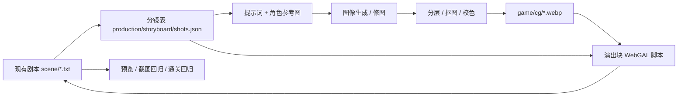

# 《夏日幻想》剧情 CG 与 2D 演出系统 · 设计开发文档

| 项目 | 内容 |
| --- | --- |
| 文档版本 | v0.1（设计稿，待评审） |
| 编写日期 | 2026-11-17 |
| 适用工程 | `D:\galgame\games\summer_fantasy` |
| 引擎 | WebGAL 4.6.6（Terre 编辑器） |
| 覆盖范围 | 序章 + 第一～七章 + GOOD / BAD 结局，共 11 个场景文件 |
| 目标 | 用"按剧情生成的 CG + 分层 2D 运镜 + 字卡"替代"一张背景走一整段"，做出 PPT 式演出 |
| 不在范围 | 改引擎源码、做全程动画电影、重写剧本/变量/分支、替换 Live2D 模型 |

---

## 0. 结论摘要（先看这七条）

1. **不需要换引擎，也不需要做视频**。WebGAL 4.6.6 的 `setTransform` / `setTempAnimation` 支持三种目标：背景 `bg-main`、舞台 `stage-main`、任意立绘 id；`changeFigure` 支持 `-zIndex` 与透明图层。把 CG 拆成"底图 + 人物 + 前景"三层，就能做推、拉、摇、移、视差、入焦，效果已经接近剪映/PPT 的"图文页 + 强调动画"。
2. **按"情绪节点"切镜，不按"每句话"切镜**。全篇规划 **40 个 shot**，其中第一梯队（MVP）**14 个**，每章 3～6 个；单章演出总时长控制在 60～90 秒。
3. **角色一致性走"双轨"**：对话和半身镜头继续用 Live2D（一致性 100%，零生成风险）；只在 Live2D 做不到的镜头（背影、手部、远景、多人合影、动态姿势）才用"以模型截图 + 角色锚点卡"生成的 CG 人物层。
4. **AI 只画画面，不画可读文字**。章节标题、手机短信、应援牌、榜单、倒计时数字、结局卡，一律用引擎 `intro` 叠加或后期排版。这条能消掉 80% 的"AI 出图翻车"。
5. **分层是这次改造的核心资产**，不是副产品。每张 CG 至少产出 `base`（无人物底图）；有人的镜头再产出 `char`（透明人物层）和可选的 `fg`（前景雨丝/窗框/光斑）。同一张底图可以复用到多个 shot，成本递减。
6. **所有演出必须是确定性的纯脚本**，可跳过、可回看、可存档，缺图时能自动降级回现有背景，绝不阻塞剧情推进。
7. **包体预算 +60MB 以内**：40 个 shot 按平均 2.2 个文件、单文件 ≤ 400KB 计算，约 35MB；参考图、提示词、源文件放在 `production/`，不随游戏发布。

> 本文既是设计说明，也是施工图：第 6 节给出 40 个 shot 的具体机位和插入位置，第 7 节给出可直接复制的 WebGAL 脚本模板，第 9 节给出从提示词到验收的完整 SOP。

---

## 1. 现状与问题

### 1.1 现有素材盘点

| 类别 | 数量 | 说明 |
| --- | ---: | --- |
| 背景 | 22 张 | 1920×1080 WebP，21 张已接入，`title_bg` 备用 |
| Live2D 模型 | 3 套 | 阮乐茹、刘熙朗、兰屿，各 10 个 `mood_*` 表情 + 2 个待机动作 |
| 内置动画 | 34 个 | `enter/exit/shake/blur/oldFilm/...`，目前剧本只用了 `pixiPerform:rain` |
| 天气特效 | 4 种 | `rain / snow / cherryBlossoms / heavySnow` |
| BGM | 1 首 | `s_Title.mp3` 贯穿全篇 |
| 语音 | 100+ 条 | 按章节命名，覆盖主要台词 |
| 剧情 CG | **0 张** | CG 鉴赏为空 |

当前演出手段只有：`changeBg` 淡入淡出 + Live2D 立绘缩放/换表情 + 下雨。全篇没有一个"镜头"概念。

### 1.2 具体问题

1. **景别单一**：所有场景都是同一张 1920×1080 全景，人物永远半身居中，缺少特写、过肩、远景。
2. **没有纵深**：没有前景层，画面像"背景板 + 贴纸"，雨丝也只能靠 Pixi 全屏粒子。
3. **转场单一**：几乎全是默认淡入淡出，情绪高点（山顶、生日、递水、擦肩）没有"画面重音"。
4. **叙事信息密度低**：书签、信纸、应援牌、榜单这些关键道具，全靠台词描述，没有给到画面。
5. **对比不足**：好结局"夏日校门"与坏结局"冬日走廊"是仅有的冷暖对比，中间章节缺少色彩记忆点。
6. **CG 鉴赏为空**：玩家没有可回看的"名场面"，二周目动力弱。

### 1.3 改造目标（可验收）

| 维度 | 目标 | 度量方式 |
| --- | --- | --- |
| 覆盖率 | 每章 ≥ 3 个 CG 演出点 | 分镜表 vs 场景文件 |
| 规模 | 全篇 40 shot（P0 14 / P1 16 / P2 10） | `production/storyboard/shots.json` |
| 节奏 | 关键节点停留 ≥ 4s，单章演出 ≤ 90s | 脚本时长统计 |
| 镜头语言 | ≥ 12 种镜头 preset，≥ 6 种转场 | 模板清单 |
| 性能 | 桌面 ≥ 55fps、移动端 ≥ 30fps；单场景常驻大图层 ≤ 3 | Chrome Performance / 真机 |
| 包体 | 增量 ≤ 60MB | 导出包对比 |
| 稳定性 | 0 脚本错误；8 条既有路线结局不变 | `validate_scene` + 自动通关 |
| 可逆性 | 跳过/自动/回看/存读档均不改变剧情结果 | 手工 + 自动回归 |
| 降级 | 缺任意 CG 时回退到现有背景，仍可通关 | 删除测试 |

---

## 2. 设计原则

1. **叙事优先**：只在"信息变化 / 情绪转折 / 空间转换"处切镜；不为炫技加镜头。一段普通对话不值得一张 CG。
2. **三层构图**：远景交代环境 → 中景交代关系 → 特写交代情绪。每章至少各一个。
3. **动效克制**：推拉幅度 ≤ 8%，单段时长 ≥ 4s，位移 ≤ 40px，缓动默认 `easeOut`/`easeInOut`。宁可"几乎不动"，也不要"PPT 抖动"。
4. **分层优先**：能拆 `base / char / fg` 就拆。拆层带来的视差和可控性，比一张"完美整图"更有价值。
5. **复用优先**：现有 21 张背景先作为 `base` 候选；同一机位只补人物层或前景层，不重复生成整张。
6. **文字后置**：一切需要"读"的内容（标题、短信、榜单、牌面、数字）都不交给图像模型。
7. **可降级**：CG 是增强，不是前置依赖；缺图时必须回落到现有背景 + 立绘。
8. **一次只加一种变量**：同一 shot 内不同时做"换背景 + 换立绘 + 大运镜 + 白闪"，避免调试困难。

### 2.1 "PPT 式"到底指什么

| PPT 元素 | 游戏内对应 | 实现手段 |
| --- | --- | --- |
| 封面页 | 章节标题卡 | `intro` + 背景 + `filmMode` |
| 目录页 | 时间/地点卡 | `intro` 两行文字 |
| 图文页 | CG + 旁白 | `changeBg` + 文本框 |
| 强调动画 | 局部推近 / 轻微放大 | `setTransform` 改 `scale` |
| 切换动画 | 推入 / 淡出 / 白闪 | `changeBg -enter/-exit` + 白图 |
| 结束页 | END 卡 | `intro` + `filmMode` |
| 演讲节奏 | 台词停顿、留白 | `wait` + 句间空行 |

目标不是"做成 PPT"，而是借用 PPT 的**分页思维**：一页只讲一件事，一页只给一个视觉重点。

---

## 3. 名词与总体架构

| 名词 | 含义 |
| --- | --- |
| shot（分镜） | 一次连续的镜头呈现，对应 3～8 秒画面 + 0～3 句台词 |
| layer（图层） | `base` 无人物底图 / `char` 透明人物层 / `fg` 透明前景层 / `fx` 光效层 |
| beat（拍） | shot 内部的最小节奏单位，通常一句台词一拍 |
| 演出块 | 一段可复制的 WebGAL 脚本，负责"进入 shot → 运镜 → 退出 shot" |
| teardown | 演出结束后的收尾：隐藏图层、恢复文本框/电影模式/BGM |
| 降级 | 素材缺失时跳过演出块，直接使用原背景 |

### 3.1 总体管线



### 3.2 分层架构（运行时）

```text
┌──────────────────────────────────────────────┐
│ 字卡 / intro（DOM，最上层）                    │
├──────────────────────────────────────────────┤
│ 文本框（WebGAL 原生 UI）                       │
├──────────────────────────────────────────────┤
│ flash 白/黑层（figure id=flash，zIndex=90）     │
│ fg 前景层（figure id=cg_fg，zIndex=30）         │
│ char 人物层（figure id=cg_char，zIndex=10）     │
│ Live2D 立绘（对话时使用，不与该层同时出现）       │
├──────────────────────────────────────────────┤
│ 背景 / CG 底图（bg-main）                      │
├──────────────────────────────────────────────┤
│ 舞台（stage-main，用于整体震动/缩放）            │
└──────────────────────────────────────────────┘
```

---

## 4. 资产规范

### 4.1 目录结构

```text
summer_fantasy/
├─ production/                    # 制作源文件，不随游戏导出
│  ├─ storyboard/
│  │  ├─ shots.json               # 分镜唯一数据源
│  │  └─ shots.schema.json
│  ├─ ref/                        # 角色参考图集
│  │  ├─ leru/
│  │  ├─ liu/
│  │  └─ lanyu/
│  ├─ prompts/                    # 每个 shot 的提示词与参数记录
│  └─ source/                     # 原始出图、psd、分层源文件
├─ game/
│  ├─ cg/                         # 发布用图层
│  │  ├─ ch00/
│  │  ├─ ch01/
│  │  ├─ ...
│  │  └─ ui/                      # white.webp / black.webp 等
│  ├─ video/                      # playVideo 专用（可选）
│  ├─ sfx/                        # 新增音效（可选）
│  └─ scene/                      # 现有剧本
└─ _tools/                        # 校验、截图、回归脚本
```

> `production/` 放在 `game/` 之外，WebGAL 导出时只会打包 `game/` 与 `lib/`，参考图和源文件不会进包。

### 4.2 命名规范

```text
<章>_<两位序号>_<内容>_<层>.webp

ch00_01_bookmark_base.webp
ch00_01_bookmark_fg.webp
ch01_03_umbrella_char.webp
ch04_02_letter_base.webp
```

- 全小写英文 + 下划线；禁止中文、空格、大写（避免 URL 编码与跨平台问题）。
- 序号在章内递增，与 `shots.json` 的 `id` 对应。
- 未验收版本加 `_v02`、`_v03`；验收通过后去掉版本后缀。
- `base` 不透明；`char` / `fg` 必须带 alpha。
- 同一 shot 的所有图层**画布尺寸与坐标必须一致**，方便直接叠加。

### 4.3 技术规格

| 项目 | 规格 |
| --- | --- |
| 画布 | 1920×1080（16:9），sRGB；不做 4K |
| 格式 | WebP（照片感/厚涂）或 PNG→WebP；透明层保留 alpha |
| 质量 | q82～88；单张 ≤ 550KB（base）/ ≤ 350KB（char、fg） |
| 安全区 | 下 300px 不放关键信息（文本框约覆盖 27%～30%） |
| 角色头部 | 位于画面上 2/3；特写时眼睛不低于 y=300 |
| 亮度 | 背景/底图整体压暗 5%～10%，给立绘和字卡留出对比 |
| 版权 | 每张图在 `prompts/<shot>.md` 记录工具、模型、种子、日期 |

### 4.4 分层规则

| 层 | 内容 | 透明 | 典型用途 |
| --- | --- | --- | --- |
| `base` | 环境、道具、无人物 | 否 | 推拉摇移的底图；可与 Live2D 叠加 |
| `char` | 人物（含必要投影） | 是 | 需要生成姿势/背影/多人时使用 |
| `fg` | 雨丝、窗框、花枝、光斑、栅栏 | 是 | 视差、景深、遮挡，制造纵深 |
| `fx` | 光晕、尘埃、白闪 | 是 | 叠加混合，慎用 |

分层注意：

1. `char` 的脚底/腰部以下可以裁掉，但**头顶和手不能贴边**，给运镜留 5% 余量。
2. `fg` 只保留画面边缘 15%～25% 的区域，中间留空，避免挡脸。
3. 人物投影画在 `char` 层内，不画在 `base` 上，否则视差时投影会"脱脚"。
4. 分层后必须做一次"叠加预览"：`base + char + fg` 三层对齐，无白边、无色差。

### 4.5 版本与清单

`production/storyboard/shots.json` 是唯一数据源，每个 shot 至少记录：

```json
{
  "id": "ch04_01_window",
  "chapter": "ch04_birthday",
  "priority": "P0",
  "anchor": { "type": "line_contains", "text": "乐茹已经坐在靠窗的位置" },
  "duration": 5200,
  "layers": ["ch04_01_window_base.webp", "ch04_01_window_char.webp"],
  "prompt": "production/prompts/ch04_01_window.md",
  "refs": ["production/ref/leru/front.png", "production/ref/leru/expr_soft.png"],
  "seed": 184729,
  "tool": "<生成工具名>",
  "status": "approved",
  "qa": { "consistency": 4, "hands": "ok", "text": "none", "safeArea": "ok" }
}
```

`status` 取值：`todo / generated / layered / approved / dropped`。没有 `approved` 的素材不允许进 `game/cg/`。

---

## 5. 角色一致性与参考体系

这是整个项目最大的风险点，也是决定"像不像同一部作品"的关键。

### 5.1 双轨策略

| 镜头类型 | 方案 | 一致性 | 成本 | 说明 |
| --- | --- | --- | --- | --- |
| 对话、半身、表情变化 | **Live2D 直接入镜** | 100% | 0 | 现有能力，继续用 |
| 背影、全身、远景、多人、手部、动态姿势 | **生成 CG 人物层** | 80%～95% | 中 | 用模型截图做参考 |
| 纯环境、道具特写 | **生成空镜** | — | 低 | 不涉及人脸，最稳 |

**优先级**：能用 Live2D 就不用生成；必须生成时，优先选"不露正脸"的构图（背影、侧影、逆光、局部、遮挡）。这不是妥协，而是视觉语言本身——青春期故事里，背影和手往往比正脸更有戏。

### 5.2 参考图集（M1 必须产出）

来源二选一：

- **Cubism Viewer**：打开 `game/figure/<角色>/<角色>.model3.json`，关闭物理/呼吸，固定参数，导出透明 PNG；
- **WebGAL 内截图**：进入预览，隐藏文本框与 UI，纯色背景，按 2× 分辨率截取，再裁切。

每个角色至少 15 张：

| 编号 | 内容 | 用途 |
| --- | --- | --- |
| `front` | 正面半身，默认表情 | 主参考 |
| `three_quarter` | 3/4 侧半身 | 侧脸镜头 |
| `side` | 正侧脸 | 对视、过肩 |
| `full` | 全身（含校服/鞋） | 远景、全身构图 |
| `back` | 背面（可由正面推断或补画） | 背影镜头 |
| `expr_*` | 10 个表情各一张 | 情绪匹配 |
| `detail_face` | 脸部特写 | 近景 |
| `detail_hand` | 手部（自然下垂/持物） | 手部特写 |
| `detail_item` | 角色专属道具（乐茹的书签、兰屿的应援牌） | 道具连续性 |

规格：PNG + alpha，长边 2048，命名 `ref/<char>/<part>.png`，纯灰底另存一份 `*_gray.png` 便于比对。

### 5.3 角色锚点卡

> **下表带 `<待填>` 的单元格，必须在 M1 用模型截图逐项确认后填写，不允许凭印象写。** 锚点卡是提示词和验收的共同依据。

| 项目 | 阮乐茹 | 刘熙朗 | 兰屿 |
| --- | --- | --- | --- |
| 发色 | `<待填>` | `<待填>` | `<待填>` |
| 瞳色 | `<待填>` | `<待填>` | `<待填>` |
| 发型 | 马尾（故事明确）/ `<待填>` | `<待填>` | `<待填>` |
| 身高/体型 | 个子不高、手小（故事明确） | 高个、校队主力 | `<待填>` |
| 校服 | `<待填>` | `<待填>` | `<待填>` |
| 标志物 | 山形木书签、素色信纸 | 篮球、毛巾、球衣 | 应援牌、饮料 |
| 气质关键词 | 安静、轻、容易脸红 | 直率、讲义气、藏心事 | 笑眯眯、活泼、藏不住 |
| 禁止项 | 成熟化、浓妆、改变身高差 | 痞化、肌肉夸张 | 女性化、幼化 |

### 5.4 生成策略阶梯

按"从省到贵"排序，能用上层就不用下层：

- **A. 空镜生成**：只生成环境，人物由 Live2D 叠加。适用于教室、走廊、球场、河堤等对话场景。
- **B. 强参考生成**：把 `front + three_quarter + expr_*` 作为多图参考，提示词写"与参考图同一角色、同一校服"，固定 seed 与风格词。适用于中景、3/4 侧。
- **C. 角色 LoRA**：用 30～50 张模型多角度/表情图训练轻量 LoRA（SDXL / Illustrious 系），再配合同系列风格模型。适用于需要大量同角色镜头的阶段。
- **D. 局部重绘/手工修**：手、眼睛、校服领口、双人交叠处，用 inpaint 或手绘修。**每张人物图都必须过这一关。**

### 5.5 参考投喂模板

```text
[参考图 1] production/ref/leru/front.png        ← 主形象
[参考图 2] production/ref/leru/three_quarter.png ← 侧脸结构
[参考图 3] production/ref/leru/expr_soft.png     ← 表情
[参考图 4] production/ref/leru/detail_item.png   ← 书签

角色：与参考图完全相同的少女，同一发型、同一校服、同一配饰；
禁止改变发色、瞳色、身高比例、校服款式。
```

不同工具的"参考"能力不同，落地时按实际工具改写，但**"同一角色 + 禁止改动项"这两句必须保留**。

### 5.6 一致性验收（1～5 分，≥4 通过）

| 检查项 | 判定标准 | 硬性 |
| --- | --- | --- |
| 发色 | 与锚点卡一致，色相偏差可接受 | 是 |
| 瞳色 | 与锚点卡一致 | 是 |
| 发型/长度 | 轮廓一致，刘海方向一致 | 是 |
| 校服 | 领型、颜色、徽章位置一致 | 是 |
| 身高差 | 双人镜头中符合设定 | 是 |
| 配饰 | 书签/应援牌/毛巾等连续 | 是 |
| 画风 | 与现有背景同一"日系动画厚涂"体系 | 是 |
| 手 | 五指数量、关节方向正确 | 是 |
| 脸型 | 与模型三视图接近，不"换人" | 是 |
| 气质 | 不成熟化、不幼化、不写实化 | 是 |

任一项不过 → 重生成或换构图（改成背影/局部/剪影），不要硬修。

### 5.7 已知难点与规避

| 难点 | 规避手段 |
| --- | --- |
| 手部崩坏 | 手持道具（书签、信纸、水瓶、伞柄）；裁切到手腕；用 `fg` 遮挡；必要时手绘 |
| 侧脸/3/4 脸漂移 | 优先用模型 `side` 参考；改成过肩或逆光剪影 |
| 双人互动（递水、握手、撑伞） | **分层生成再合成**：两人分别生成，在 PS/ComfyUI 里按透视摆放，统一光源 |
| 多人合影（结局四人） | 不做一张整图；用"空景校门 + 四个透明人物层 + 统一投影"合成 |
| 文字/数字乱码 | 画面留白，文字后期叠加（见 7.6） |
| 复杂姿势 | 改构图：背影、侧影、局部、远景小人物 |
| 风格漂移 | 固定风格前缀 + 固定负面词 + 同批次生成；每章先出 1 张"风格锚图"再批量 |

---
<!-- CONTINUE -->