收到，删除 **“图书馆自习”** 和 **“文化祭搭档”** 这两个支线。以下是受影响的更新内容，其余设定、关键分歧、刘熙朗×兰屿副CP、双结局判定均保持不变。

---

## 一、第一章日常支线更新版

删除原支线3“图书馆自习”和支线4“文化祭搭档”，重新编号如下：

| 新编号 | 支线           | 作用           |
| ------ | -------------- | -------------- |
| 支线1  | 值日扫地       | 好感、熙朗信任 |
| 支线2  | 雨天借伞       | 好感、熙朗信任 |
| 支线3  | 兰屿的试探     | 好感、兰屿助攻 |
| 支线4  | 篮球场边的兰屿 | 副线埋线       |

### 支线1：值日扫地（保留）
你和乐茹同组值日，她够不到黑板高处。

**选项：**
1. 帮她一起做完值日 → 好感 +5  
2. 先走让她收尾 → 好感 -2  
3. 叫刘熙朗来帮忙 → 熙朗信任 +3，好感 +1

### 支线2：雨天借伞（保留）
放学突然下雨，乐茹没带伞，站在你桌边看你：“同桌……你带伞了吗？”

**选项：**
1. 把伞给她，自己等雨停 → 好感 +5  
2. 和她共撑一把伞去公交站 → 好感 +8  
3. 打电话让刘熙朗送伞 → 熙朗信任 +3，好感 +2

### 支线3：兰屿的试探（原支线5）
兰屿趴在你们课桌边，笑眯眯问：“同桌，你觉得乐茹怎么样？”

**选项：**
1. 老实说“她很特别” → 好感 +5，兰屿成为助攻  
2. 打哈哈“就同学啊” → 好感 -3  
3. 反问“她怎么看我？” → 好感 +2，兰屿笑而不语

### 支线4：篮球场边的兰屿（原支线6）
放学后刘熙朗在球场打球，你路过时看到兰屿拉着乐茹站在场边。

- 兰屿眼睛发亮：“熙朗那个三分也太帅了吧。”
- 乐茹小声吐槽：“你到底是来看球还是来看人？”
- 兰屿脸红，把饮料塞给乐茹：“别乱说。”

**选项：**
1. 过去和熙朗打招呼，顺便把乐茹她们介绍过去 → 熙朗信任 +3，好感 +2，副线标记 +1  
2. 只远远看一会儿 → 副线标记 +1  
3. 拉乐茹去买水，不打扰 → 好感 +3

---

## 二、学业值来源确认

删除“图书馆自习”后，学业值的主要来源变为第七章升学冲刺：

- 初始学业：20
- 好线第七章自动：+20 → 40
- 第七章选择“每周和乐茹去图书馆自习”：+10 → **50**

因此好结局 **学业≥50** 仍然可达，但必须选择“每周去图书馆”。若选“偶尔复习”（+3）则为 43，不满足好结局条件，会进入坏结局。这符合原设计，不需要额外补学业支线。

---

## 三、更新后的详细流程图

```mermaid
flowchart TD
    START([start.txt<br/>变量初始化<br/>leru_fav=10, study=20<br/>liu_trust=30, side_flag=0<br/>key1=none, key2=none<br/>gave_up=false]) --> PROLOGUE

    PROLOGUE[ch00_prologue.txt<br/>换座位·阮乐茹成为同桌<br/>初始好感小场景] --> DAILY

    DAILY[ch01_daily.txt<br/>日常支线累积]
    DAILY --> D1[支线1：值日扫地]
    DAILY --> D2[支线2：雨天借伞]
    DAILY --> D3[支线3：兰屿的试探]
    DAILY --> D4[支线4：篮球场边的兰屿<br/>副线埋线]

    D1 --> SAT
    D2 --> SAT
    D3 --> SAT
    D4 --> SAT

    SAT[ch02_saturday.txt<br/>关键分歧1：周六撞车]
    SAT --> C1{周六选择}

    C1 -->|去爬山| MTN[爬山线<br/>key1=mountain<br/>leru_fav +15<br/>liu_trust −10<br/>side_flag +2<br/>兰屿看熙朗篮球视频]
    C1 -->|去开黑| GAME[开黑线<br/>key1=game<br/>leru_fav −15<br/>liu_trust +10<br/>side_flag +1<br/>乐茹失望]

    MTN --> SAT_MERGE[汇合]
    GAME --> SAT_MERGE

    SAT_MERGE --> BDAY_PRE[ch03_birthday_pre.txt<br/>关键分歧2：生日筹备]
    BDAY_PRE --> C2{是否为乐茹<br/>准备礼物和信？}

    C2 -->|准备| GIFT[礼物线<br/>key2=gift<br/>leru_fav +25<br/>山形书签+素色信纸]
    C2 -->|不准备| NOGIFT[无礼物线<br/>key2=nogift<br/>leru_fav −25<br/>口头祝福]

    GIFT --> BDAY[ch04_birthday.txt<br/>乐茹生日<br/>关系升温]
    NOGIFT --> BDAY_COLD[ch04_birthday.txt<br/>乐茹生日<br/>关系冷却]

    BDAY --> LIU
    BDAY_COLD --> LIU

    LIU[ch05_liu_heart.txt<br/>刘熙朗心事<br/>生日之后]
    LIU --> C3{如何回应熙朗<br/>喜欢乐茹}

    C3 -->|坦白我也喜欢她| HONEST[坦白线<br/>liu_trust +15<br/>leru_fav +3<br/>一起讨论乐茹]
    C3 -->|鼓励熙朗去追| PUSH[鼓励线<br/>liu_trust +3<br/>leru_fav −8<br/>误会]
    C3 -->|装傻| DUMB[装傻线<br/>liu_trust −3]

    HONEST --> LIU2
    PUSH --> LIU2
    DUMB --> LIU2

    LIU2{熙朗看到乐茹<br/>对你有好感后的收束}
    LIU2 -->|谢谢熙朗，不影响兄弟| BRO_OK[兄弟认可<br/>liu_trust +5<br/>leru_fav +3]
    LIU2 -->|为了兄弟退出| GIVEUP[退出线<br/>gave_up=true<br/>leru_fav −15]
    LIU2 -->|鼓励熙朗继续，自己旁观| WATCH[旁观线<br/>leru_fav −10<br/>liu_trust +3]

    BRO_OK --> BASKET
    GIVEUP --> BASKET
    WATCH --> BASKET

    BASKET[ch06_basketball.txt<br/>篮球赛·兰屿应援熙朗<br/>副CP升温] --> C4{篮球赛后的行动}

    C4 -->|帮熙朗和兰屿创造机会| SIDE_HI[副线高<br/>side_flag +3<br/>liu_trust +3]
    C4 -->|只顾和乐茹说话| SIDE_MID[副线中<br/>leru_fav +3<br/>side_flag +1]
    C4 -->|拿应援牌开玩笑| SIDE_TEASE[副线触发<br/>side_flag +2]

    SIDE_HI --> FINAL
    SIDE_MID --> FINAL
    SIDE_TEASE --> FINAL

    FINAL[ch07_final.txt<br/>升学冲刺]
    FINAL --> EARLY{关键选择<br/>是否全部正确？<br/>key1=mountain<br/>key2=gift<br/>gave_up=false}

    EARLY -->|否| BAD_EARLY[提前进入坏线判定]
    EARLY -->|是| STUDY{升学复习选择}

    STUDY -->|每周图书馆| ST_HI[study +20 自动<br/>再 +10<br/>leru_fav +5]
    STUDY -->|偶尔复习| ST_MID[study +20 自动<br/>再 +3]
    STUDY -->|经常缺席| ST_LO[study +20 自动<br/>再 −5<br/>leru_fav −5]

    ST_HI --> JUDGE
    ST_MID --> JUDGE
    ST_LO --> JUDGE

    JUDGE{最终判定<br/>leru_fav ≥ 55<br/>study ≥ 50}
    JUDGE -->|满足| GOOD[GOOD END<br/>同一所高中的恋人<br/>乐茹×主角<br/>熙朗×兰屿<br/>四人同校]
    JUDGE -->|不满足| BAD[BAD END<br/>视同陌生人的路人同学<br/>走廊擦肩<br/>副CP甜蜜对比]

    BAD_EARLY --> BAD
```

---

## 四、需要同步删除的文本位置

在 `ch01_daily.txt` 中删除以下两段：

1. 原“支线3：图书馆自习”全部内容及选项；
2. 原“支线4：文化祭搭档”全部内容及选项。

同时删除以下引用：

- 兰屿提醒中“乐茹数学最近有点吃力”的图书馆相关句；
- 文化祭展板、搬设备相关对话；
- 制作提示中“图书馆自习”“文化祭搭档”的条目。

---

## 五、更新后的日常支线数量与节点

- 第一章日常支线：**4 条**（值日、雨天、兰屿试探、篮球场边兰屿）。
- 流程图节点 `D3`、`D4` 已分别替换为“兰屿的试探”“篮球场边的兰屿”，不再有图书馆和文化祭节点。
- 场景文件仍为 `ch01_daily.txt`，只是内部段落减少，不需要新增或删除场景文件。

---

## 六、测试清单补充

| 测试项                       | 预期                                                |
| ---------------------------- | --------------------------------------------------- |
| 第一章不再出现图书馆自习选项 | 无“主动坐过去一起复习”等选项                        |
| 第一章不再出现文化祭搭档选项 | 无展板、搬设备相关对话                              |
| 好结局学业值                 | 初始20 + 第七章自动20 + 每周图书馆10 = 50，满足判定 |
| 选“偶尔复习”                 | 学业43，不满足好结局，进入坏结局                    |
| 兰屿试探仍可触发             | 好感 +5 / -3 / +2 正常                              |
| 篮球场边兰屿仍可触发         | 副线标记正常累积                                    |

其余开发流程、变量系统、关键分歧脚本、结局判定、测试清单均不变。